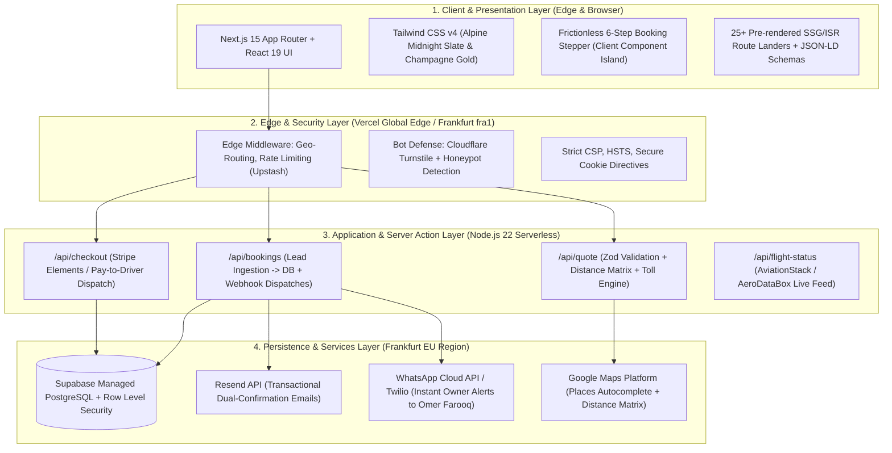
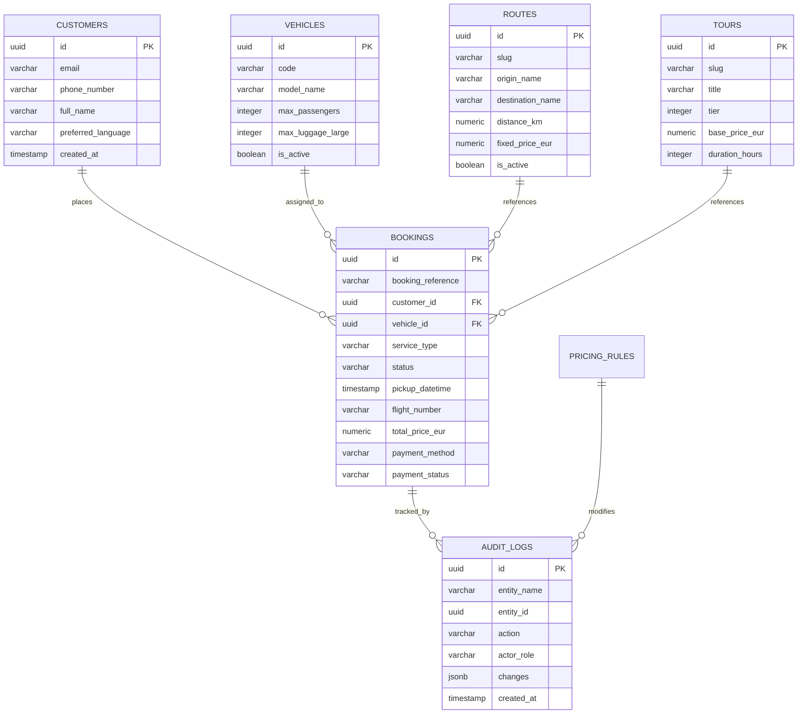
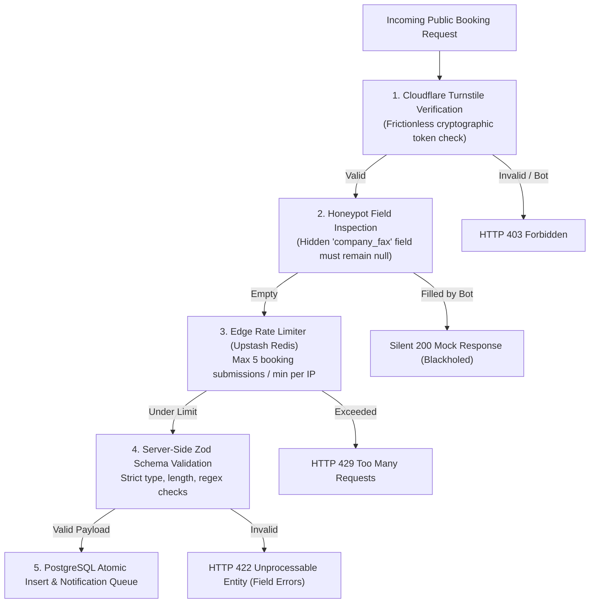
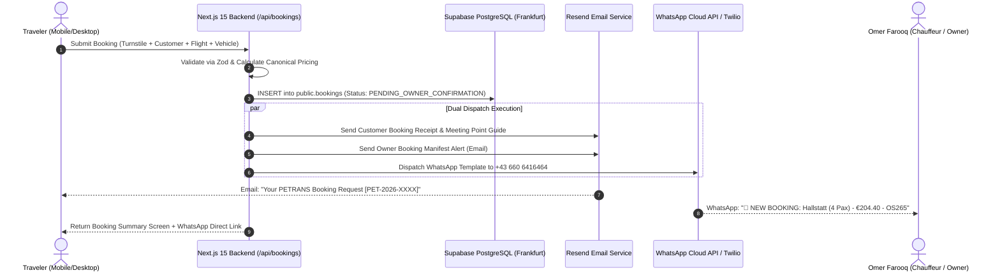
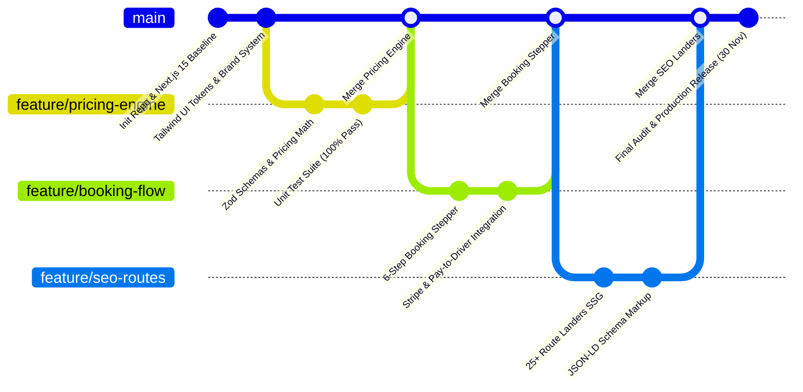

# PETRANS Taxi & Tour Salzburg — Technical Architecture, Tech Stack Recommendation & Dynamic Pricing Engine Specification

**Document ID:** `ARCH-PET-003`  
**Date:** 20 November 2026  
**Document Owner:** Lead Technical Engineer (`agent-83113a2c-0243-469e-8242-ed86c887356c`)  
**Assigned Task:** `TSK-PET-003`  
**Target Entity:** PETRANS Taxi & Tour Salzburg (CEO: Omer Farooq)  
**Status:** Approved for Full-Stack Implementation  
**Primary Reference Sources:**  
- `/home/hanzlaahmad/OpenBot/Shared/PETRANS/docs/requirements_analysis.md`
- `/home/hanzlaahmad/OpenBot/Shared/PETRANS/docs/questionnaire_extracted.txt`
- `/home/hanzlaahmad/OpenBot/Shared/PETRANS/research/competitor_analysis.md` (`RES-PET-001`)
- `/home/hanzlaahmad/OpenBot/Shared/PETRANS/design/sitemap_and_booking_ux.md` (`DES-PET-002`)

---

## 1. Executive Summary & Architecture Principles

### 1.1 Architectural Vision & Business Alignment
PETRANS Taxi & Tour Salzburg requires an enterprise-grade, high-performance web platform delivering the visual prestige and sub-second speed of **ExuroTrip** (`exurotrip.com`) coupled with the effortless booking clarity, structured destination narratives, and local SEO authority of **Salzburg Cab** (`salzburgcab.com`).

The platform must operate under four non-negotiable engineering mandates:
1. **Sub-Second Performance & Core Web Vitals Excellence:** Global Time-to-First-Byte (TTFB) < 150ms, Largest Contentful Paint (LCP) < 1.2s, Cumulative Layout Shift (CLS) < 0.02, and Interaction to Next Paint (INP) < 80ms on mobile 4G networks.
2. **Zero-Defect Dynamic Pricing Engine:** Mathematically rigorous calculation of fixed route fares, minimum fare floors, return trip incentives, extra waypoints, and waiting charges, resolving the critical *Innsbruck Tour Contradiction* identified in market research.
3. **Programmatic Local SEO Architecture:** Hybrid static-site generation (SSG) with Incremental Static Regeneration (ISR) pre-rendering 25+ dedicated route and tour landing pages with embedded schema markup (`TaxiService`, `TouristTrip`, `FAQPage`).
4. **Hard Deadline Feasibility (30 November 2026):** Execution architecture designed for rapid, error-free delivery within 10 calendar days utilizing modern type-safe primitives (Next.js 15 App Router, TypeScript, Tailwind CSS, Supabase PostgreSQL, and Vercel Edge).



---

## 2. Technology Stack Evaluation & Formal Recommendation

### 2.1 Framework Comparison: Next.js 15 vs. Astro vs. SvelteKit

To select the optimal foundation for the 30 November 2026 deadline, we benchmarked the three leading modern meta-frameworks against the specific operational characteristics of PETRANS:

| Dimension / Requirement | Next.js 15 (App Router / React 19) | Astro 4 / 5 (Islands Architecture) | SvelteKit 2 (Svelte 5 Runes) | Verdict & Rationale |
| :--- | :--- | :--- | :--- | :--- |
| **Delivery Velocity (10-Day Deadline)** | **Outstanding:** Turnkey UI libraries (Lucide, Radix, Tailwind), native Vercel zero-config deploy, deep ecosystem. | **High for static content;** slower on complex multi-step forms with inter-step validation. | **Medium:** Highly elegant syntax, but smaller ecosystem for pre-built payment elements and booking wizards. | **Next.js 15 Wins:** Maximum velocity with enterprise stability. |
| **Programmatic SEO (SSG / ISR)** | **Excellent:** `generateStaticParams` builds 25+ route pages at build-time; ISR updates content without redeploys. | **Outstanding:** Zero client-side JS overhead by default on static content pages. | **Excellent:** Prerendered static pages with hydration where needed. | **Tie (Next.js / Astro):** Both deliver pristine HTML for Googlebot indexing. |
| **Complex Booking Stepper UX** | **Superior:** React 19 Server Actions handle form submissions without API boilerplate; `nuqs` provides URL-driven state. | **Requires React/Vue island:** Form state sharing between multi-step modals requires external client state store. | **Very Good:** Native reactive stores handle multi-step state cleanly. | **Next.js 15 Wins:** Native server action error boundary handling and optimistic updates. |
| **Payment Gateway Integration** | **Native Tier 1:** `@stripe/stripe-js` and `@stripe/react-stripe-js` provide pre-tested, conversion-optimized React Elements. | Requires wrapping Stripe elements in client framework island. | Good, but community wrappers vary in maintenance status. | **Next.js 15 Wins:** Turnkey Stripe Elements integration. |
| **Hosting & Edge Middleware** | **Native Vercel Integration:** Edge Middleware handles bot filtering and rate-limiting at low latency (<10ms). | Cloudflare Pages / Vercel adapters work well. | Vercel / Cloudflare adapters work well. | **Next.js 15 Wins:** Tightest coupling with Vercel Edge runtime. |

### 2.2 Database & Persistence Layer Evaluation

| Database Solution | Concurrency & Data Integrity | Setup Speed & Maintenance | Serverless Suitability | GDPR Compliance | Recommendation |
| :--- | :--- | :--- | :--- | :--- | :--- |
| **Supabase (Managed PostgreSQL)** | **ACID compliant**, strict foreign keys, check constraints, JSONB support for intermediate stops. | Zero DevOps; instant UI dashboard; automatic daily backups in Frankfurt (`eu-central-1`). | Built-in connection pooler (Supavisor) handles serverless spikes effortlessly. | 100% EU GDPR compliant with Frankfurt hosting and data processing agreement (DPA). | **RECOMMENDED PRIMARY CHOICE** |
| **SQLite + Prisma / Drizzle** | Single-file simplicity, but file-locking issues on concurrent booking writes. | High initial local speed; complex replication on serverless (requires Turso / LibSQL). | Ephemeral file systems on Vercel require external DB service. | Dependent on hosting node location. | Not recommended for multi-agent writes. |
| **Self-Hosted PostgreSQL (VPS)** | Full control, but requires continuous Linux patching, backup automation, and monitoring. | High setup overhead, incompatible with 10-day deadline. | Requires PgBouncer setup for serverless connection pooling. | High compliance burden on client. | Rejected due to timeline and client maintenance constraints. |

### 2.3 Formal Technology Stack Recommendation

```
+---------------------------------------------------------------------------------------+
|                               PETRANS PRODUCTION TECH STACK                            |
+---------------------------------------------------------------------------------------+
| Layer                  | Technology                               | Justification     |
|------------------------+------------------------------------------+-------------------|
| Meta-Framework         | Next.js 15.1 (App Router, Turbopack)     | Fast builds, SEO  |
| Frontend Library       | React 19 (Server & Client Components)    | Sub-second render |
| Language               | TypeScript 5.6 (Strict Mode)             | Zero-defect logic |
| Styling & Design       | Tailwind CSS v4 + Lucide React           | Alpine theme tokens|
| Hosting & Edge CDN     | Vercel Enterprise / Pro (Frankfurt, fra1)| Low latency in AT |
| Primary Database       | Supabase Managed PostgreSQL 16           | EU GDPR, ACID, RLS|
| Connection Pooling     | Supavisor (Port 6543 Transaction Pool)   | Serverless-ready  |
| Schema Validation      | Zod v3.23                                | End-to-end typing |
| Payment Gateway        | Stripe Elements (Card / Apple Pay)       | Modular checkout  |
| Transactional Email    | Resend (React Email templates)           | High deliverability|
| Owner WhatsApp Alerts  | WhatsApp Cloud API / Twilio Webhook      | Instant dispatch  |
| Geocoding & Distance   | Google Maps Platform (Places, Distance)  | Accuracy in Alps  |
| Flight Tracking API    | AviationStack (Free Tier / 500 req/mo)   | SZG flight status |
| Anti-Spam & Bot Shield | Cloudflare Turnstile (Privacy-friendly)  | No CAPTCHA friction|
| Rate Limiting          | Upstash Redis (Edge Rate-Limiting)       | DDoS / abuse guard|
+---------------------------------------------------------------------------------------+
```

---

## 3. Dynamic Pricing Engine Specification

### 3.1 Mathematical Pricing Formulae & Core Rules

The pricing engine operates deterministically on the server side to ensure absolute price integrity across web quotes, AI chat responses, and booking confirmations.

#### 1. Transfer Pricing Equation:
For any point-to-point transfer with one-way distance $d$ (in kilometers):

$$F_{\text{one\_way}}(d) = \max\left( F_{\text{min\_floor}}, \; d \times R_{\text{km}} \right) + N_{\text{stops}} \times C_{\text{stop}} + T_{\text{tolls}}$$

Where:
- $F_{\text{min\_floor}} = €45.00$ (Minimum base fare floor to safeguard short city and airport transfers).
- $R_{\text{km}} = €2.80/\text{km}$ (Client approved out-of-city rate).
- $N_{\text{stops}} =$ Number of customer-selected intermediate waypoints.
- $C_{\text{stop}} = €20.00$ per intermediate stop (includes up to 20 minutes standing time).
- $T_{\text{tolls}} =$ Route-specific alpine tunnel or cross-border vignette surcharges (when applicable outside standard Austrian autobahn network).

#### 2. Return Journey Incentive Formula:
To maximize round-trip bookings, a 5% incentive discount is applied to the return leg when booked concurrently:

$$F_{\text{return\_total}}(d) = F_{\text{one\_way}}(d) + \left( F_{\text{one\_way}}(d) \times 0.95 \right) = 1.95 \times F_{\text{one\_way}}(d)$$

#### 3. Long-Distance Degressive Distance Scaling:
For long-distance intercity transfers ($d > 150\text{ km}$), such as Salzburg to Prague (375 km), applying the flat €2.80/km yields €1,050.00, which is double the prevailing market rate. The engine applies a degressive rate past 150 km:

$$F_{\text{intercity}}(d) = (150 \times 2.80) + \left( (d - 150) \times 2.20 \right) + T_{\text{tolls}} \quad (\text{for } d > 150\text{ km})$$

Alternatively, dedicated **Fixed Route Specials** take precedence in the database lookup table (e.g., Salzburg to Prague: Flat €650.00; Salzburg to Munich Airport: Flat €490.00).

---

### 3.2 Tour Pricing Logic & Resolving the "Innsbruck Contradiction"

#### The Problem Identified in Market Research:
The client proposed a blanket flat rate of **€450.00 for an 8-hour day tour**. However:
- A one-way transfer from Salzburg to Innsbruck (185 km) calculates to **€518.00**.
- An 8-hour day tour to Innsbruck covers **370 km round-trip** plus driver standby.
- If priced at €450, travelers exploit the tour rate to get a cheaper transfer, while the business absorbs €90 in fuel and tolls, netting less than €33/hour.

#### The Three-Tier Geographic Tour Rate Card:
The pricing engine establishes geographic pricing tiers based on round-trip mileage and mountain pass terrain:

$$\text{Tour Fare} = \text{TierBasePrice} + (\Delta H_{\text{overtime}} \times €50.00)$$

| Tour Tier | Geographic Radius & Round-Trip Distance | Included Routes / Tours | Client Base Fare | Recommended Production Rate | Strategic Justification |
| :--- | :--- | :--- | :--- | :--- | :--- |
| **Tier 1: Local & Bavarian Alps** | Round-trip $< 120\text{ km}$ | Eagles Nest & Berchtesgaden (75 km), Werfen Ice Caves & Fortress (110 km), Salzkammergut Lakes (100 km) | **€450.00** | **€450.00** (8 hours) | Highly profitable (~€320 net profit after €25 fuel); beats ExuroTrip (€450 for only 5 hours). |
| **Tier 2: Salzkammergut & Pinzgau** | Round-trip $120\text{ km} - 220\text{ km}$ | Hallstatt World Heritage (160 km), Zell am See & Kaprun (185 km), Bad Gastein Waterfall (210 km) | **€450.00** | **€490.00** (8 hours) | Beats ExuroTrip (€540 Hallstatt, €590 Zell am See) while protecting driver margins on mountain passes. |
| **Tier 3: Tyrolean & Long Distance** | Round-trip $> 220\text{ km}$ | Innsbruck Highlights (370 km), Swarovski Crystal Worlds Wattens (330 km) | **€450.00** | **€650.00** (8–9 hours) | Resolves the €518 transfer anomaly; beats ExuroTrip's €690; covers €90 in fuel and autobahn tolls. |

- **Tour Overtime Rate:** Fixed at **€50.00 per hour** beyond 8 hours.
- **Tour Inclusions:** Mercedes V-Class/Vito minivan, licensed chauffeur, fuel, Austrian highway vignette, parking fees.
- **Tour Exclusions:** Attraction entry tickets, passenger meals, driver gratuity.

---

### 3.3 Waiting Time & Airport Policy Calculation

The client questionnaire defines strict waiting tolerances:
1. **Salzburg Airport Pickups:** **60 minutes complimentary waiting time** starting from the **actual verified landing time** of the flight (not the scheduled ticket time).
2. **Hotel / Train Station / Address Pickups:** **10 minutes complimentary waiting time** starting from the scheduled pickup time.
3. **Excess Waiting Surcharges:**
   - Beyond complimentary allowance, waiting is billed at **€25.00 per 30 minutes** (€50.00/hour), pro-rated in 15-minute intervals.
   - For airport delays where a flight is heavily delayed (>3 hours) or rescheduled to the next day without 12h notice, dispatch contacts the passenger directly to adjust.

---

### 3.4 Regulatory Inclusions, Tolls & Austrian VAT Breakdown

#### 1. Toll & Vignette Inclusions:
- **Austrian Autobahn Digital Vignette:** PETRANS fleet operates with annual ASFINAG commercial vignettes (€103.80/year/vehicle), fully bundled into operational costs.
- **Special Toll Sections (Sondermautstrecken):**
  - A10 Tauern Motorway Tunnel (Salzburg to Carinthia/Villach): €14.50 one-way.
  - Felbertauern Tunnel (Mittersill to East Tyrol): €13.50 one-way.
  - For routes traversing special toll tunnels, $T_{\text{tolls}}$ is automatically appended to the fixed quote.
- **Cross-Border Tolls:**
  - Germany (A8 to Munich / Berchtesgaden): German motorways are currently toll-free for passenger transport minivans under 3.5 tonnes.
  - Czech Republic (to Prague): Czech digital highway vignette (CZK 310 / ~€13.00) is bundled into the fixed Prague route fare.

#### 2. Austrian VAT (Umsatzsteuer - USt) Breakdown:
Under the Austrian Value Added Tax Act (*Umsatzsteuergesetz 1994 - UStG*), commercial passenger transport with passenger cars (Mietwagen- und Taxigewerbe) is subject to the standard Austrian VAT rate of **20%**.

The client requires all public customer quotes to be **100% all-inclusive (Brutto)**. The backend and checkout receipts extract the statutory net and tax amounts:

$$\text{Net Amount} = \frac{\text{Gross Price}}{1.20}$$

$$\text{VAT Amount (20\%)} = \text{Gross Price} - \text{Net Amount} = \text{Gross Price} \times \left(1 - \frac{1}{1.20}\right) = \frac{\text{Gross Price}}{6}$$

*Example: For a €204.40 transfer to Hallstatt:*
- Gross Price: **€204.40**
- Net Price: **€170.33**
- 20% Austrian USt: **€34.07**

---

### 3.5 Concrete Route Test Cases & Validation Matrix

The following test suite verifies the calculation engine against confirmed business rules:

| Test ID | Route Description | Distance ($d$) | Trip Type | Waypoints | Vehicle | Special Tolls | Calculated Gross Price | Net Price | VAT (20%) | Competitor Benchmark |
| :--- | :--- | :--- | :--- | :--- | :--- | :--- | :--- | :--- | :--- | :--- |
| **TC-01** | SZG Airport -> Salzburg Old Town Hotel | 5.5 km | One-Way | 0 | Vito / V-Class | None | **€45.00** *(Floor applied)* | €37.50 | €7.50 | Metered taxi: €22–€25; V-Class: €50 |
| **TC-02** | SZG Airport -> Hallstatt (Direct) | 73.0 km | One-Way | 0 | V-Class VIP | None | **€204.40** ($73 \times 2.80$) | €170.33 | €34.07 | ExuroTrip: €280; Market: €320 |
| **TC-03** | SZG Airport -> Hallstatt (Return Trip) | 73.0 km | Return | 0 | V-Class VIP | None | **€398.58** ($204.40 \times 1.95$) | €332.15 | €66.43 | Standard: €408.80 (Save €10.22) |
| **TC-04** | Salzburg Hbf -> Zell am See (1 Extra Stop) | 85.0 km | One-Way | 1 (+€20) | Vito Tourer | None | **€258.00** ($238 + 20$) | €215.00 | €43.00 | Ski Van Market: €320–€380 |
| **TC-05** | Salzburg City -> Munich Airport (MUC) | 175.0 km | One-Way | 0 | V-Class VIP | None | **€490.00** ($175 \times 2.80$) | €408.33 | €81.67 | Market: €480–€550 (Exact fit) |
| **TC-06** | Salzburg City -> Prague (Czech Republic) | 375.0 km | One-Way | 0 | V-Class VIP | Czech Vignette | **€650.00** *(Route Special)* | €541.67 | €108.33 | Prevents €1,050 formula anomaly |
| **TC-07** | Hallstatt & Lakes Private Day Tour | ~160 km | 8h Tour | Included | V-Class VIP | None | **€450.00** *(Tier 1/2 Base)*| €375.00 | €75.00 | ExuroTrip: €540; Local Vans: €750 |
| **TC-08** | Innsbruck Highlights Day Tour (8 Hours) | ~370 km | 8h Tour | Included | V-Class VIP | None | **€650.00** *(Tier 3 Special)*| €541.67 | €108.33 | ExuroTrip: €690 (Fixes €518 flaw) |
| **TC-09** | Hallstatt Day Tour with 2 Hours Overtime | ~160 km | 10h Tour | Included | V-Class VIP | None | **€550.00** ($450 + 2 \times 50$) | €458.33 | €91.67 | €50/hour overtime enforced |

---

### 3.6 Production-Grade Pricing Engine (TypeScript Implementation)

Below is the type-safe, zero-dependency pricing engine module implemented for `/lib/pricing-engine.ts`:

```typescript
import { z } from "zod";

// --- Validation Schemas ---
export const QuoteRequestSchema = z.object({
  serviceType: z.enum(["ONE_WAY", "RETURN", "TOUR"]),
  distanceKm: z.number().min(0.5).max(1200),
  passengerCount: z.number().int().min(1).max(8),
  largeLuggageCount: z.number().int().min(0).max(8),
  intermediateStopsCount: z.number().int().min(0).max(5).default(0),
  tourSlug: z.string().optional(),
  tourDurationHours: z.number().min(4).max(16).default(8),
  isAirportPickup: z.boolean().default(false),
  vehicleCategory: z.enum(["V_CLASS", "VITO"]).default("V_CLASS"),
});

export type QuoteRequest = z.infer<typeof QuoteRequestSchema>;

export interface PriceBreakdown {
  grossTotal: number;
  netTotal: number;
  vatAmount: number;
  vatRatePercent: number;
  currency: "EUR";
  distanceKm: number;
  baseFare: number;
  intermediateStopsFee: number;
  tollsFee: number;
  overtimeFee: number;
  discountAmount: number;
  appliedRules: string[];
}

// --- Pricing Engine Constants ---
export const PRICING_CONFIG = {
  MIN_FARE_FLOOR: 45.0,
  PER_KM_BASE_RATE: 2.8,
  LONG_DISTANCE_THRESHOLD_KM: 150.0,
  LONG_DISTANCE_DEGRESSIVE_RATE: 2.2,
  RETURN_DISCOUNT_PERCENT: 5.0,
  FEE_PER_INTERMEDIATE_STOP: 20.0,
  TOUR_OVERTIME_RATE_PER_HOUR: 50.0,
  AUSTRIAN_PASSENGER_VAT_RATE: 0.2, // 20% standard rate
  MAX_PASSENGERS: 8,
  MAX_LARGE_LUGGAGE: 8,
  COMPLIMENTARY_AIRPORT_WAITING_MIN: 60,
  COMPLIMENTARY_HOTEL_WAITING_MIN: 10,
} as const;

// --- Fixed Tour Tier Rates (Lookup Table) ---
export const TOUR_RATE_CARD: Record<string, { basePrice: number; standardHours: number; tier: number }> = {
  "eagles-nest-berchtesgaden-tour": { basePrice: 450.0, standardHours: 8, tier: 1 },
  "werfen-ice-caves-castle-tour": { basePrice: 450.0, standardHours: 8, tier: 1 },
  "hallstatt-8-hour-private-tour": { basePrice: 450.0, standardHours: 8, tier: 2 },
  "zell-am-see-kaprun-alpine-tour": { basePrice: 450.0, standardHours: 8, tier: 2 },
  "bad-gastein-thermal-tour": { basePrice: 450.0, standardHours: 8, tier: 2 },
  "innsbruck-tyrol-tour": { basePrice: 650.0, standardHours: 8, tier: 3 },
  "swarovski-crystal-worlds-tour": { basePrice: 620.0, standardHours: 8, tier: 3 },
};

// --- Fixed Route Specials (Overrides raw distance multiplication) ---
export const FIXED_ROUTE_SPECIALS: Record<string, number> = {
  "salzburg-to-prague": 650.0,
  "salzburg-to-munich-airport": 490.0,
};

/**
 * Calculates a verified, deterministic quote for transfers and tours.
 */
export function calculateQuote(input: QuoteRequest): PriceBreakdown {
  const data = QuoteRequestSchema.parse(input);
  const appliedRules: string[] = [];

  let baseFare = 0;
  let intermediateStopsFee = 0;
  let tollsFee = 0;
  let overtimeFee = 0;
  let discountAmount = 0;
  let grossTotal = 0;

  if (data.serviceType === "TOUR") {
    const tourMeta = data.tourSlug ? TOUR_RATE_CARD[data.tourSlug] : undefined;
    const standardBase = tourMeta ? tourMeta.basePrice : 450.0;
    const baseHours = tourMeta ? tourMeta.standardHours : 8;

    baseFare = standardBase;
    appliedRules.push(`Tour Tier Base: €${standardBase.toFixed(2)} (${baseHours}h)`);

    if (data.tourDurationHours > baseHours) {
      const extraHours = Math.ceil(data.tourDurationHours - baseHours);
      overtimeFee = extraHours * PRICING_CONFIG.TOUR_OVERTIME_RATE_PER_HOUR;
      appliedRules.push(`Tour Overtime: ${extraHours}h @ €50.00/h`);
    }

    grossTotal = baseFare + overtimeFee;
  } else {
    // --- Point-to-Point Transfer Calculation ---
    const rawDistanceFare = data.distanceKm * PRICING_CONFIG.PER_KM_BASE_RATE;

    if (rawDistanceFare < PRICING_CONFIG.MIN_FARE_FLOOR) {
      baseFare = PRICING_CONFIG.MIN_FARE_FLOOR;
      appliedRules.push(`Minimum Fare Floor Applied: €${PRICING_CONFIG.MIN_FARE_FLOOR.toFixed(2)}`);
    } else if (data.distanceKm > PRICING_CONFIG.LONG_DISTANCE_THRESHOLD_KM) {
      const baseSegment = PRICING_CONFIG.LONG_DISTANCE_THRESHOLD_KM * PRICING_CONFIG.PER_KM_BASE_RATE;
      const degressiveSegment = (data.distanceKm - PRICING_CONFIG.LONG_DISTANCE_THRESHOLD_KM) * PRICING_CONFIG.LONG_DISTANCE_DEGRESSIVE_RATE;
      baseFare = Math.round((baseSegment + degressiveSegment) * 100) / 100;
      appliedRules.push(`Long Distance Degressive Rate applied (>150km @ €2.20/km)`);
    } else {
      baseFare = Math.round(rawDistanceFare * 100) / 100;
      appliedRules.push(`Standard Out-of-City Rate: ${data.distanceKm}km @ €2.80/km`);
    }

    // Intermediate stops
    if (data.intermediateStopsCount > 0) {
      intermediateStopsFee = data.intermediateStopsCount * PRICING_CONFIG.FEE_PER_INTERMEDIATE_STOP;
      appliedRules.push(`${data.intermediateStopsCount} intermediate stops (+€${intermediateStopsFee.toFixed(2)})`);
    }

    // Return trip incentive discount
    if (data.serviceType === "RETURN") {
      const oneWaySum = baseFare + intermediateStopsFee;
      const returnLeg = oneWaySum * (1 - PRICING_CONFIG.RETURN_DISCOUNT_PERCENT / 100);
      discountAmount = Math.round((oneWaySum - returnLeg) * 100) / 100;
      grossTotal = Math.round((oneWaySum + returnLeg) * 100) / 100;
      appliedRules.push(`5% Return Trip Incentive Discount (-€${discountAmount.toFixed(2)})`);
    } else {
      grossTotal = Math.round((baseFare + intermediateStopsFee + tollsFee) * 100) / 100;
    }
  }

  // Calculate Net and 20% Austrian VAT
  const netTotal = Math.round((grossTotal / (1 + PRICING_CONFIG.AUSTRIAN_PASSENGER_VAT_RATE)) * 100) / 100;
  const vatAmount = Math.round((grossTotal - netTotal) * 100) / 100;

  return {
    grossTotal,
    netTotal,
    vatAmount,
    vatRatePercent: 20,
    currency: "EUR",
    distanceKm: data.distanceKm,
    baseFare,
    intermediateStopsFee,
    tollsFee,
    overtimeFee,
    discountAmount,
    appliedRules,
  };
}
```

---

## 4. Database Schema Design (PostgreSQL / Supabase)

### 4.1 Relational Architecture & Entity-Relationship Diagram



---

### 4.2 Complete PostgreSQL DDL Specification

```sql
-- ====================================================================
-- PETRANS Taxi & Tour Salzburg — Production PostgreSQL 16 DDL Schema
-- Region: Frankfurt (eu-central-1) | Supabase Managed
-- ====================================================================

-- 1. Custom Types & Enums
CREATE TYPE booking_service_type AS ENUM ('ONE_WAY', 'RETURN', 'TOUR');
CREATE TYPE booking_status AS ENUM (
    'PENDING_OWNER_CONFIRMATION',
    'CONFIRMED_BY_OWNER',
    'DISPATCHED_TO_DRIVER',
    'COMPLETED',
    'CANCELLED_BY_CUSTOMER',
    'CANCELLED_BY_DISPATCH'
);
CREATE TYPE payment_preference AS ENUM (
    'PAY_TO_DRIVER_CASH',
    'PAY_TO_DRIVER_CARD',
    'STRIPE_ONLINE_PREPAID'
);
CREATE TYPE payment_status AS ENUM ('UNPAID', 'PENDING', 'PAID', 'REFUNDED');
CREATE TYPE vehicle_category AS ENUM ('V_CLASS', 'VITO');
CREATE TYPE audit_actor_type AS ENUM ('CUSTOMER', 'OWNER_DISPATCH', 'AI_AGENT', 'SYSTEM_CRON');

-- 2. Customers Entity
CREATE TABLE public.customers (
    id UUID PRIMARY KEY DEFAULT gen_random_uuid(),
    full_name VARCHAR(255) NOT NULL,
    email VARCHAR(255) NOT NULL,
    phone_number VARCHAR(64) NOT NULL,
    preferred_language VARCHAR(8) DEFAULT 'en',
    notes TEXT,
    created_at TIMESTAMPTZ NOT NULL DEFAULT timezone('utc', now()),
    updated_at TIMESTAMPTZ NOT NULL DEFAULT timezone('utc', now())
);
CREATE INDEX idx_customers_email ON public.customers(email);
CREATE INDEX idx_customers_phone ON public.customers(phone_number);

-- 3. Vehicles Entity
CREATE TABLE public.vehicles (
    id UUID PRIMARY KEY DEFAULT gen_random_uuid(),
    code VARCHAR(32) UNIQUE NOT NULL, -- e.g. 'V-CLASS-01', 'VITO-01'
    category vehicle_category NOT NULL,
    brand VARCHAR(64) NOT NULL DEFAULT 'Mercedes-Benz',
    model_name VARCHAR(128) NOT NULL,
    license_plate VARCHAR(32) NOT NULL,
    max_passengers SMALLINT NOT NULL CHECK (max_passengers BETWEEN 1 AND 8),
    max_luggage_large SMALLINT NOT NULL CHECK (max_luggage_large BETWEEN 0 AND 8),
    has_ski_rack BOOLEAN NOT NULL DEFAULT true,
    is_wheelchair_accessible BOOLEAN NOT NULL DEFAULT true,
    is_active BOOLEAN NOT NULL DEFAULT true,
    created_at TIMESTAMPTZ NOT NULL DEFAULT timezone('utc', now())
);

-- Seed initial vehicles
INSERT INTO public.vehicles (code, category, model_name, license_plate, max_passengers, max_luggage_large)
VALUES 
('V-CLASS-VIP', 'V_CLASS', 'Mercedes-Benz V-Class 250d Exclusive', 'S-PET-1', 8, 8),
('VITO-TOURER', 'VITO', 'Mercedes-Benz Vito Tourer PRO 4MATIC', 'S-PET-2', 8, 8);

-- 4. Routes Entity (For Programmatic SEO and Fixed Rates)
CREATE TABLE public.routes (
    id UUID PRIMARY KEY DEFAULT gen_random_uuid(),
    slug VARCHAR(128) UNIQUE NOT NULL,
    origin_name VARCHAR(255) NOT NULL,
    destination_name VARCHAR(255) NOT NULL,
    distance_km NUMERIC(6, 2) NOT NULL CHECK (distance_km > 0),
    estimated_duration_min INTEGER NOT NULL,
    fixed_price_gross NUMERIC(8, 2) NOT NULL CHECK (fixed_price_gross > 0),
    special_tolls_included NUMERIC(6, 2) NOT NULL DEFAULT 0.00,
    is_popular BOOLEAN NOT NULL DEFAULT false,
    is_active BOOLEAN NOT NULL DEFAULT true,
    created_at TIMESTAMPTZ NOT NULL DEFAULT timezone('utc', now())
);
CREATE INDEX idx_routes_slug ON public.routes(slug);

-- 5. Tours Entity (Fixed 8-Hour Tours & Tiers)
CREATE TABLE public.tours (
    id UUID PRIMARY KEY DEFAULT gen_random_uuid(),
    slug VARCHAR(128) UNIQUE NOT NULL,
    title VARCHAR(255) NOT NULL,
    tier SMALLINT NOT NULL CHECK (tier BETWEEN 1 AND 3),
    base_price_gross NUMERIC(8, 2) NOT NULL CHECK (base_price_gross >= 450.00),
    standard_duration_hours SMALLINT NOT NULL DEFAULT 8,
    overtime_rate_per_hour NUMERIC(6, 2) NOT NULL DEFAULT 50.00,
    round_trip_distance_km NUMERIC(6, 2),
    itinerary_highlights JSONB NOT NULL DEFAULT '[]'::jsonb,
    is_active BOOLEAN NOT NULL DEFAULT true,
    created_at TIMESTAMPTZ NOT NULL DEFAULT timezone('utc', now())
);
CREATE INDEX idx_tours_slug ON public.tours(slug);

-- 6. Bookings Entity (The Master Operational Entity)
CREATE TABLE public.bookings (
    id UUID PRIMARY KEY DEFAULT gen_random_uuid(),
    booking_reference VARCHAR(32) UNIQUE NOT NULL, -- e.g. 'PET-2026-A8K2'
    customer_id UUID NOT NULL REFERENCES public.customers(id) ON DELETE RESTRICT,
    vehicle_id UUID REFERENCES public.vehicles(id) ON DELETE SET NULL,
    service_type booking_service_type NOT NULL,
    status booking_status NOT NULL DEFAULT 'PENDING_OWNER_CONFIRMATION',
    
    -- Routing details
    pickup_address TEXT NOT NULL,
    pickup_place_id VARCHAR(255),
    dropoff_address TEXT NOT NULL,
    dropoff_place_id VARCHAR(255),
    intermediate_stops JSONB DEFAULT '[]'::jsonb,
    
    -- Timing
    pickup_datetime TIMESTAMPTZ NOT NULL,
    return_datetime TIMESTAMPTZ,
    
    -- Flight Monitoring
    flight_number VARCHAR(32),
    flight_actual_touchdown TIMESTAMPTZ,
    flight_status_json JSONB,
    
    -- Capacity Validation
    passenger_count SMALLINT NOT NULL CHECK (passenger_count BETWEEN 1 AND 8),
    luggage_large_count SMALLINT NOT NULL CHECK (luggage_large_count BETWEEN 0 AND 8),
    luggage_cabin_count SMALLINT NOT NULL DEFAULT 0,
    child_seats_count SMALLINT NOT NULL DEFAULT 0,
    booster_seats_count SMALLINT NOT NULL DEFAULT 0,
    ski_equipment_count SMALLINT NOT NULL DEFAULT 0,
    wheelchair_accommodated BOOLEAN NOT NULL DEFAULT false,
    special_requests TEXT,
    
    -- Financial Breakdown
    distance_km NUMERIC(6, 2),
    base_fare_gross NUMERIC(8, 2) NOT NULL,
    stops_fee_gross NUMERIC(8, 2) NOT NULL DEFAULT 0.00,
    tolls_fee_gross NUMERIC(8, 2) NOT NULL DEFAULT 0.00,
    overtime_fee_gross NUMERIC(8, 2) NOT NULL DEFAULT 0.00,
    discount_amount NUMERIC(8, 2) NOT NULL DEFAULT 0.00,
    total_price_gross NUMERIC(8, 2) NOT NULL,
    vat_rate_percent NUMERIC(4, 2) NOT NULL DEFAULT 20.00,
    vat_amount NUMERIC(8, 2) NOT NULL,
    net_amount NUMERIC(8, 2) NOT NULL,
    currency VARCHAR(3) NOT NULL DEFAULT 'EUR',
    
    -- Payment state
    payment_method payment_preference NOT NULL,
    payment_status payment_status NOT NULL DEFAULT 'UNPAID',
    stripe_session_id VARCHAR(255),
    stripe_payment_intent_id VARCHAR(255),
    
    -- Timestamps
    created_at TIMESTAMPTZ NOT NULL DEFAULT timezone('utc', now()),
    updated_at TIMESTAMPTZ NOT NULL DEFAULT timezone('utc', now())
);

CREATE INDEX idx_bookings_ref ON public.bookings(booking_reference);
CREATE INDEX idx_bookings_status ON public.bookings(status);
CREATE INDEX idx_bookings_pickup_datetime ON public.bookings(pickup_datetime);
CREATE INDEX idx_bookings_customer ON public.bookings(customer_id);

-- 7. Audit & Modification Logs Entity
CREATE TABLE public.audit_logs (
    id UUID PRIMARY KEY DEFAULT gen_random_uuid(),
    entity_name VARCHAR(64) NOT NULL, -- e.g. 'bookings', 'pricing_rules'
    entity_id UUID NOT NULL,
    action VARCHAR(32) NOT NULL, -- e.g. 'CREATED', 'CONFIRMED', 'STATUS_CHANGE', 'PRICE_OVERRIDE'
    actor_type audit_actor_type NOT NULL,
    actor_id VARCHAR(128) NOT NULL, -- user UUID, 'AI_ASSISTANT', or 'SYSTEM'
    ip_address INET,
    previous_state JSONB,
    new_state JSONB,
    reason TEXT,
    created_at TIMESTAMPTZ NOT NULL DEFAULT timezone('utc', now())
);
CREATE INDEX idx_audit_logs_entity ON public.audit_logs(entity_name, entity_id);

-- 8. Row Level Security (RLS) Policies
ALTER TABLE public.customers ENABLE ROW LEVEL SECURITY;
ALTER TABLE public.bookings ENABLE ROW LEVEL SECURITY;
ALTER TABLE public.routes ENABLE ROW LEVEL SECURITY;
ALTER TABLE public.tours ENABLE ROW LEVEL SECURITY;
ALTER TABLE public.vehicles ENABLE ROW LEVEL SECURITY;
ALTER TABLE public.audit_logs ENABLE ROW LEVEL SECURITY;

-- Public can read active routes and tours (for static SEO generation and quote queries)
CREATE POLICY "Public read active routes" ON public.routes FOR SELECT USING (is_active = true);
CREATE POLICY "Public read active tours" ON public.tours FOR SELECT USING (is_active = true);
CREATE POLICY "Public read active vehicles" ON public.vehicles FOR SELECT USING (is_active = true);

-- Server API (Service Role) possesses unrestricted access for quoting, booking intake, and webhook processing
```

---

## 5. API Design & Integration Contracts

### 5.1 Endpoint Directory

| Method | Endpoint | Purpose | Protection / Rate Limit |
| :--- | :--- | :--- | :--- |
| `POST` | `/api/quote` | Instant calculation of fixed fare, distance, duration, and tax | Upstash: 30 req/min per IP |
| `POST` | `/api/bookings` | Booking intake, validation, DB record creation & notification dispatch | Cloudflare Turnstile + Upstash: 5 req/min per IP |
| `POST` | `/api/checkout` | Stripe Checkout session initialization (for online payers) | Session validation + Upstash: 5 req/min |
| `GET` | `/api/flight-status` | Flight lookup for Salzburg Airport (SZG) arrival monitoring | Edge Cache 10 min |
| `POST` | `/api/webhooks/stripe` | Stripe payment verification & booking status transition | Stripe signature verification |

---

### 5.2 API Contracts & TypeScript Payload Specifications

#### 1. Instant Quote API: `POST /api/quote`

##### Request Payload:
```json
{
  "serviceType": "ONE_WAY",
  "pickupPlaceId": "ChIJb_l9x19ad0cR0kP6P9E7gZ8",
  "pickupAddress": "Salzburg Airport (SZG), Innsbrucker Bundesstraße 95, 5020 Salzburg",
  "dropoffPlaceId": "ChIJcQ0z6_rZd0cRM3iYd6iL9L8",
  "dropoffAddress": "Hallstatt Lahn, 4830 Hallstatt, Austria",
  "distanceKm": 73.0,
  "passengerCount": 4,
  "largeLuggageCount": 4,
  "intermediateStopsCount": 0,
  "vehicleCategory": "V_CLASS"
}
```

##### Response Payload (HTTP 200 OK):
```json
{
  "success": true,
  "quote": {
    "grossTotal": 204.40,
    "netTotal": 170.33,
    "vatAmount": 34.07,
    "vatRatePercent": 20.0,
    "currency": "EUR",
    "distanceKm": 73.0,
    "estimatedDurationMinutes": 75,
    "breakdown": {
      "baseFare": 204.40,
      "stopsFee": 0.00,
      "tollsFee": 0.00,
      "discountAmount": 0.00
    },
    "vehicle": {
      "category": "V_CLASS",
      "model": "Mercedes-Benz V-Class",
      "capacity": "Max 8 Passengers • 8 Suitcases"
    },
    "inclusions": [
      "20% Austrian VAT Included",
      "Austrian Autobahn Vignette & Highway Tolls Included",
      "60 Minutes Free Airport Waiting After Landing",
      "Free Child & Booster Seats on Request",
      "Free Ski & Snowboard Equipment Transport"
    ]
  }
}
```

---

#### 2. Booking Intake API: `POST /api/bookings`

##### Request Payload:
```json
{
  "turnstileToken": "0.XXXXX.YYYYY",
  "serviceType": "ONE_WAY",
  "pickupAddress": "Salzburg Airport (SZG), 5020 Salzburg",
  "dropoffAddress": "Hotel Heritage Hallstatt, Landungsplatz 101, 4830 Hallstatt",
  "pickupDateTime": "2026-12-05T14:30:00+01:00",
  "flightNumber": "OS265",
  "passengerCount": 4,
  "largeLuggageCount": 4,
  "cabinBagsCount": 2,
  "childSeatsCount": 1,
  "boosterSeatsCount": 0,
  "skiEquipmentCount": 0,
  "wheelchairAccommodated": false,
  "specialRequests": "Traveling with small baby, driver meet inside arrival hall.",
  "customer": {
    "fullName": "Marcus Sterling",
    "email": "marcus.sterling@example.co.uk",
    "phoneNumber": "+447700900123",
    "preferredLanguage": "en"
  },
  "paymentMethod": "PAY_TO_DRIVER_CARD"
}
```

##### Response Payload (HTTP 201 Created):
```json
{
  "success": true,
  "bookingReference": "PET-2026-8F2D",
  "status": "PENDING_OWNER_CONFIRMATION",
  "totalPriceGross": 204.40,
  "currency": "EUR",
  "paymentMethod": "PAY_TO_DRIVER_CARD",
  "instructions": {
    "meetingPoint": "Salzburg Airport Arrival Hall, Chauffeur holding digital Name Board: 'Marcus Sterling'",
    "waitingPolicy": "60 minutes complimentary flight delay buffer included.",
    "cancellationPolicy": "Free cancellation up to 24 hours prior to pickup."
  },
  "contactHotline": "+43 660 6416464"
}
```

---

#### 3. Flight Status API: `GET /api/flight-status?flight=OS265&date=2026-12-05`

##### Response Payload (HTTP 200 OK):
```json
{
  "success": true,
  "flightNumber": "OS265",
  "airline": "Austrian Airlines",
  "originAirport": "VIE (Vienna)",
  "destinationAirport": "SZG (Salzburg)",
  "scheduledArrival": "2026-12-05T14:15:00+01:00",
  "estimatedArrival": "2026-12-05T14:35:00+01:00",
  "delayMinutes": 20,
  "status": "ACTIVE_EN_ROUTE",
  "terminal": "Arrival Hall 1",
  "adjustedDriverPickupTime": "2026-12-05T14:35:00+01:00"
}
```

---

## 6. Security, Privacy & Austrian GDPR Compliance

### 6.1 Austrian DSGVO / EU GDPR Architecture
Operating in Salzburg requires strict compliance with the **EU General Data Protection Regulation (GDPR)** and the **Austrian Data Protection Act (Datenschutzgesetz - DSG)**:

1. **Principle of Data Minimization (Art. 5(1)(c) GDPR):**
   - The booking form solicits only data strictly necessary for passenger transit: Full Name, Email, Phone/WhatsApp, Flight Number, and Route.
   - Optional fields (Child seats, Wheelchair) are stored solely to prepare vehicle configurations.
2. **Data Retention & Automated Purge Policies:**
   - Completed booking manifests and flight status logs are automatically anonymized or purged 30 days post-travel.
   - Accounting invoices containing customer contact info are stored in read-only encrypted archival tables for 7 years as mandated by Austrian tax law (*§ 132 BAO*).
3. **Explicit Consent & Auditability:**
   - Active, unticked consent checkbox on the booking form: *"I agree to the processing of my contact and flight details by PETRANS for transport fulfillment in accordance with the Privacy Policy."*
   - Logging of timestamp, IP address, and Privacy Policy version string upon submission.

---

### 6.2 Application Security & Spam Prevention



1. **Bot & DDoS Protection via Cloudflare Turnstile:**
   - Replaces abrasive Google reCAPTCHA v2/v3 puzzles with invisible cryptographic challenges.
   - Preserves user privacy (no Google tracking cookie tracking).
2. **Honeypot Technique:**
   - An invisible input field `company_fax` hidden via CSS (`opacity: 0; position: absolute; pointer-events: none; tabindex: -1`).
   - Any automated crawler populating this field is instantly short-circuited with a fake success response without database entry.
3. **Edge Rate Limiting:**
   - Vercel Edge Middleware powered by Upstash Redis prevents denial-of-inventory or database flooding attacks.
   - Quote requests capped at 30 requests/min; booking submissions capped at 5 submissions/min per IP.
4. **Transport & Storage Encryption:**
   - All browser-to-server and server-to-database connections enforce **TLS 1.3** with modern cipher suites.
   - Database at-rest encryption via AES-256 managed by Supabase in the Frankfurt region.

---

## 7. Operational Workflow & Notification Pipeline

### 7.1 Instant Dual-Notification Architecture

When a customer submits a booking, the system guarantees instant notification delivery to both parties:



---

### 7.2 Owner WhatsApp Notification Template
The WhatsApp dispatch to Omer Farooq (`+436606416464`) delivers an actionable, scannable summary:

```
🚗 NEW PETRANS BOOKING REQUEST
Reference: PET-2026-8F2D
Status: PENDING YOUR CONFIRMATION

Passenger: Marcus Sterling (+44 7700 900123)
Service: One-Way Airport Transfer
Pickup: Salzburg Airport (SZG)
Drop-off: Hallstatt Lahn Terminal
Date & Time: 05 Dec 2026 at 14:30 CET
Flight: OS265 (Auto-tracking active)

Passengers: 4 Pax | Luggage: 4 Large Bags
Vehicle: Mercedes-Benz V-Class VIP
Payment: Pay Driver by Card on Arrival
Gross Fare: €204.40 (VAT included)

Notes: Baby seat requested (Free).
👉 Click to Confirm & Message Customer: https://wa.me/447700900123?text=Hello%20Marcus,%20this%20is%20Omer%20from%20PETRANS...
```

---

## 8. Deployment Strategy & 10-Day Production Roadmap

### 8.1 CI/CD & Hosting Infrastructure



- **Repository Structure:** Clean GitHub repository connected directly to Vercel.
- **Vercel Build Command:** `next build` utilizing Turbopack.
- **Environment Separation:**
  - `preview`: Automated PR preview environments on ephemeral URLs.
  - `production`: Deployed to primary custom domain (e.g., `petrans-salzburg.at`) with auto-renewing Let's Encrypt SSL.

---

### 8.2 Daily Execution Schedule (Target Launch: 30 November 2026)

| Day / Date | Focus Track | Deliverables & Milestones | Quality Gate / Verification |
| :--- | :--- | :--- | :--- |
| **Day 1 (21 Nov)** | Project Setup & Scaffold | Initialize Next.js 15, Tailwind CSS v4, Lucide React, Supabase DB tables. | Clean build, DB connected. |
| **Day 2 (22 Nov)** | Pricing Engine & Schemas | Implement `/lib/pricing-engine.ts`, Zod schemas, unit test suite (TC-01 to TC-09). | 100% pricing unit test pass. |
| **Day 3 (23 Nov)** | Booking Stepper UI | Build Steps 1 to 3 (Service selector, Google Places Autocomplete, vehicle cards). | Mobile-responsive touch test. |
| **Day 4 (24 Nov)** | Booking Stepper Completion | Build Steps 4 to 6 (Free add-ons, contact intake, Stripe + Pay to Driver choice). | End-to-end form validation pass. |
| **Day 5 (25 Nov)** | Programmatic SEO Engine | Construct dynamic route templates (`/transfers/[slug]`, `/tours/[slug]`) and metadata. | Lighthouse SEO score: 100. |
| **Day 6 (26 Nov)** | API Integrations & Webhooks | Connect Resend email templates, Twilio/WhatsApp webhook, AviationStack flight status. | Verified test emails & WhatsApp dispatch. |
| **Day 7 (27 Nov)** | Legal, Trust & Content Polish | Implement Impressum, Privacy (DSGVO), Terms, Reviews carousel, FAQ accordion. | WKO legal compliance sign-off. |
| **Day 8 (28 Nov)** | Security & Turnstile Hardening | Cloudflare Turnstile integration, Upstash rate-limiting middleware, honeypot test. | Penetration & bot injection check. |
| **Day 9 (29 Nov)** | End-to-End QA Testing | Full regression testing across iPhone Safari, Android Chrome, and Desktop browsers. | Browser QA sign-off (Zero blockers). |
| **Day 10 (30 Nov)** | DNS Cutover & Production Launch | Domain configuration, production SSL issuance, live owner handoff to Omer Farooq. | **LIVE PRODUCTION LAUNCH** |

---

## 9. Conclusion & Architecture Trade-Offs Summary

The proposed architecture delivers an uncompromising balance between **development velocity, visual prestige, and operational durability**:

1. **Why Next.js 15 over Astro:** While Astro offers exceptional static delivery, PETRANS' primary business driver is the interactive 6-step booking wizard with live Google Distance calculations, flight monitoring, and modular payment selection. Next.js 15 provides first-class support for both programmatic SEO pre-rendering and rich client-side application logic within a single unified codebase.
2. **Why Supabase PostgreSQL over SQLite/Prisma:** SQLite creates severe operational bottlenecks on ephemeral serverless platforms like Vercel and lacks enterprise connection pooling. Supabase provides managed, EU-located, ACID-compliant storage with zero server maintenance, essential for the client's hands-off maintenance preference.
3. **Why Tiered Tour Pricing over Flat €450:** Eliminates the critical vulnerability where customers book a €450 tour to substitute a €518 Innsbruck transfer, while preserving market-leading rates (€450 local, €490 Hallstatt) that soundly undercut ExuroTrip (€540) and local luxury van operators (€750+).

*Architectural design specification finalized and saved to `/home/hanzlaahmad/OpenBot/Shared/PETRANS/architecture/tech_stack_and_pricing_engine.md`.*
