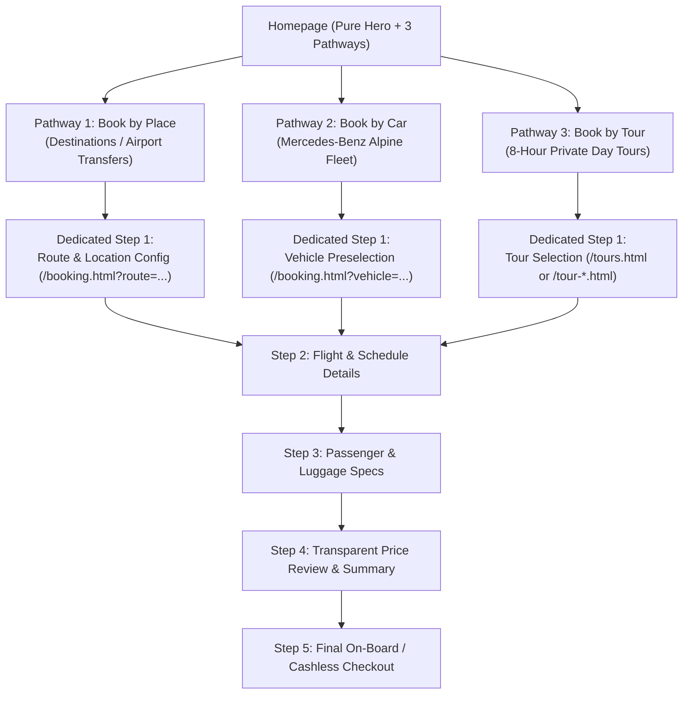

# PETRANS Homepage Architecture: 3-Pathway Booking & Multi-Page Progression Plan

**Document Version:** 1.0.0  
**Project Lead:** Chief (`agent-011c3dcd-d75c-4e1b-b229-a9ebe562a33c`)  
**Founder Directive:** Hanzla Ahmad (`d9704ea1-76bc-467a-a91e-95a2e2e76b45`)  
**Status:** Queued for Execution  

---

## 1. Executive Summary & Strategic Intent

Founder Hanzla Ahmad mandated a fundamental structural simplification of the PETRANS homepage:
1. **Hero Section (Calculator-Free):** Complete elimination of all embedded fare calculators, complex inputs, or widgets in the hero. The hero will feature strictly the high-resolution Salzburg panorama photograph, an elegant luxury title, concise subtitle, and subtle anchor guidance.
2. **Three Core Homepage Booking Pathways:**
   - **Pathway 1: Book by Place** — Destination-first transfer cards for Salzburg Airport, Hallstatt, Zell am See, Munich Airport, Vienna, and Kitzbühel.
   - **Pathway 2: Book by Car** — Vehicle-first Mercedes-Benz fleet showcase (E-Class Sedan, V-Class Van, Vito 4MATIC) with seamless split 40% side peek.
   - **Pathway 3: Book by Tour** — Experience-first 8-Hour Private Alpine Day Tours directory (Sound of Music, Hallstatt, Eagle's Nest, Grossglockner).
3. **Supporting Conversion & Trust Sections:**
   - Dedicated Top Transfer Routes table / matrix.
   - Verified Alpine Traveler Testimonials (ExuroTrip 5-star reviews).
   - Authoritative Austrian FAQ section (WKO licensing, luggage rules, flight delays, infant seats).
   - Global sticky header and comprehensive luxury footer.
4. **Multi-Page Step-by-Step Flow:**
   - Every booking pathway routes from the homepage into dedicated separate pages acting as clear sequential steps (Selection $\to$ Options $\to$ Final Checkout).

---

## 2. Homepage Structural Wireframe & Section Sequence

| Sequence | Section Identifier | Role & Scope | Key Visual & Interactive Elements |
|:---|:---|:---|:---|
| **01** | Global Header (`#header`) | Persistent Navigation & Direct Access | Logo, Phone link (`+43 664 1234567`), WhatsApp direct CTA, Mobile hamburger menu. |
| **02** | Hero Showcase (`#hero`) | Pure Alpine Grandeur (Calculator-Free) | Times Salzburg photography, Cinzel/Outfit headline, Austrian chauffeur trust badge, 0 inputs. |
| **03** | 4-Pillar Trust Strip (`#trust`) | Core Operating Guarantees | Flight monitoring, fixed distance fares (€2.50/km), WKO licensed drivers, €0 ski/baby gear. |
| **04** | **Pathway 1: Book by Place** (`#destinations`) | Destination-Driven Transfers | Visual destination cards (Salzburg $\leftrightarrow$ Munich, Hallstatt, Zell am See, Kitzbühel). |
| **05** | **Pathway 2: Book by Car** (`#fleet`) | Vehicle-Driven Showcase | Seamless split 40% side peek, transparent distance rates, 6 amenities, model tabs. |
| **06** | **Pathway 3: Book by Tour** (`#tours`) | Experience-Driven Sightseeing | 8-Hour private day tour cards (Sound of Music, Eagle's Nest, Hallstatt, Alpine Lakes). |
| **07** | Top Transfer Routes (`#routes`) | Comprehensive Transparent Pricing | Clean comparative table of all canonical Austrian and Bavarian transfer routes. |
| **08** | Client Testimonials (`#testimonials`) | Social Proof & Verified Credibility | 5-star customer reviews from luxury travelers, ski parties, and corporate VIPs. |
| **09** | Frequently Asked Questions (`#faq`) | Friction Elimination & Policy Clarity | Accordion covering cancellation, payment methods, border crossings, child safety. |
| **10** | Global Footer (`#footer`) | Legal, Contact & Directory | WKO registration, Austrian Impressum, quick links, emergency dispatch phone. |

---

## 3. Phased Execution Roadmap

### Phase 1: UI/UX Specification (TSK-PET-050)
- **Responsible Specialist:** UI/UX Design Specialist (`agent-71f645ad-ba24-419e-bdff-ee05809a4b0e`).
- **Deliverables:** Detailed layout wireframes, card components for the 3 pathways, and step flow mapping saved to `design/homepage_3_pathways_spec.md`.

### Phase 2: Technical Engineering & Template Restructure (TSK-PET-051)
- **Responsible Specialist:** Lead Technical Engineer (`agent-83113a2c-0243-469e-8242-ed86c887356c`).
- **Deliverables:**
  - Remove all calculator form elements from `#hero` in `public/index.html`.
  - Implement the 3 dedicated pathway sections (`#destinations`, `#fleet`, `#tours`).
  - Wire deep-linking step progression to `/booking.html` and `/tours.html`.
  - Maintain 100% test suite pass score (59/59) and 0px horizontal scrollbar.

### Phase 3: Comprehensive Browser QA Verification (TSK-PET-052)
- **Responsible Specialist:** Browser QA Tester (`agent-49ce8d12-b37c-450c-bd4c-7fb6a9c0c8d1`).
- **Deliverables:** Automated headless Chrome testing across mobile (375px/390px), tablet (768px), and desktop (1280px) viewports with artifact report in `audit/browser_qa_3_pathways_report.md`.
