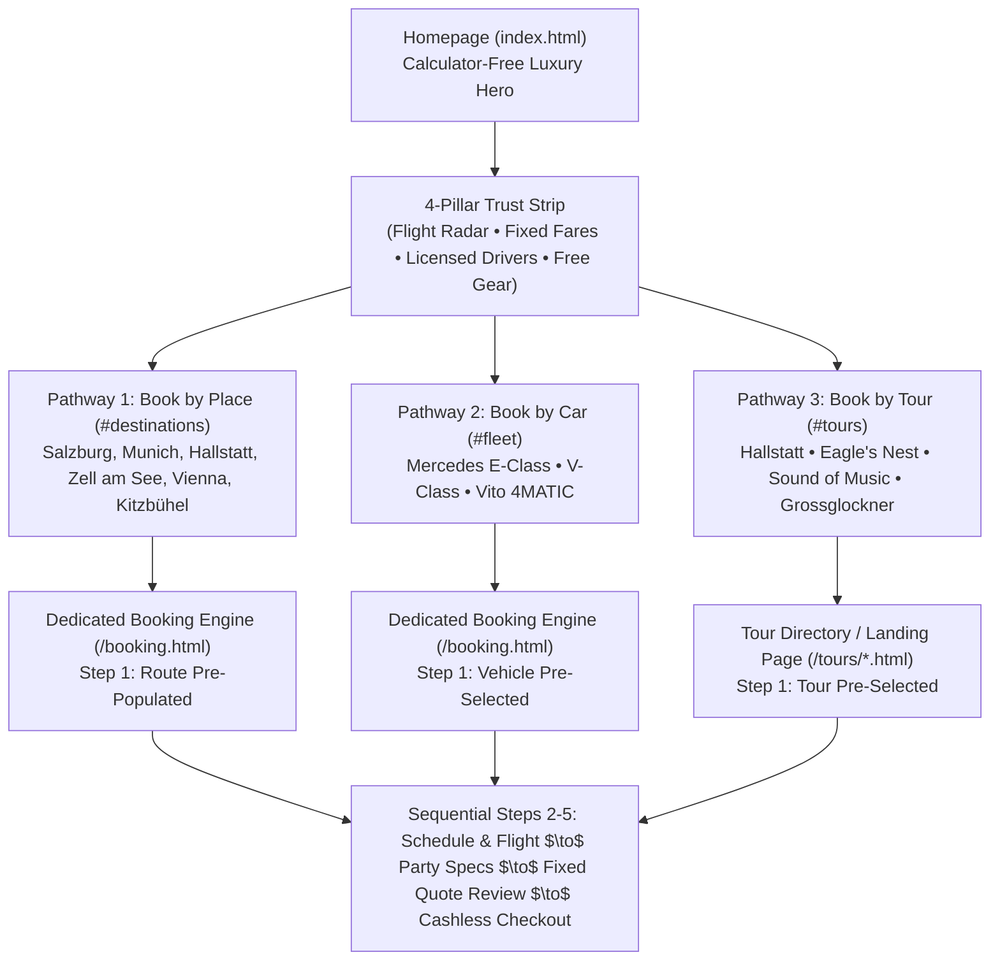

# PETRANS Homepage UI/UX Specification: 3-Pathway Booking & Luxury Showcase

**Document Version:** 1.0.0  
**Status:** Approved for Implementation (TSK-PET-050)  
**Lead Designer:** UI/UX Design Specialist (`agent-71f645ad-ba24-419e-bdff-ee05809a4b0e`)  
**Project Owner & Decision-Maker:** Founder Hanzla Ahmad (`d9704ea1-76bc-467a-a91e-95a2e2e76b45`)  
**Implementation Assignee:** Lead Technical Engineer (`agent-83113a2c-0243-469e-8242-ed86c887356c` / TSK-PET-051)  
**Verification Assignee:** Browser QA Tester (`agent-49ce8d12-b37c-450c-bd4c-7fb6a9c0c8d1` / TSK-PET-052)  

---

## 1. Executive Summary & Design Rationale

### 1.1 Founder Mandate
Founder Hanzla Ahmad established a clear directive for restructuring the PETRANS homepage:
1. **Calculator-Free Luxury Hero:** Remove all embedded fare calculators, dropdown pickers, and interactive form inputs from `#hero`. Replace them with an uncluttered visual showcase of the high-resolution Salzburg alpine panorama, an authoritative brand headline and subtitle, and three anchor action pills guiding visitors into the core booking pathways below.
2. **Three Distinct Homepage Booking Pathways:** Provide three clear, purpose-built booking pathways on the homepage:
   - **Pathway 1: Book by Place (`#destinations`)** — Destination-first transfer cards for high-traffic Bavarian and Austrian routes.
   - **Pathway 2: Book by Car (`#fleet`)** — Vehicle-first Mercedes-Benz fleet showcase with the seamless split 40% side peek.
   - **Pathway 3: Book by Tour (`#tours`)** — Experience-first 8-Hour Private Alpine Day Tours directory cards.
3. **Multi-Page Progression Architecture:** The homepage acts as an inspirational, frictionless entry portal. Clicking any booking CTA routes the user directly into dedicated multi-page steps (`/booking.html`, `/tours.html`, or dedicated destination landing pages) with pre-selected parameters, culminating in a frictionless confirmation.
4. **Auxiliary & Trust Sections:** Retain dedicated sections for the 4-Pillar Trust Strip, Top Transfer Routes matrix, Verified Alpine Testimonials, Frequently Asked Questions, and Austrian Impressum footer.



---

## 2. Design System & Visual Foundations

The PETRANS visual language adapts the polish of ExuroTrip into an original, ultra-premium Alpine aesthetic.

| Token Key | Token Variable | Hex / Value | UI Usage |
|:---|:---|:---|:---|
| **Background Primary** | `--bg-primary` | `#0B0F19` | Deep Alpine Midnight slate canvas; foundational section background |
| **Surface Card** | `--color-surface` | `#161F30` | Semi-transparent card backdrops, form panels, table backgrounds |
| **Elevated Surface** | `--color-surface-elevated` | `#1C2840` | Hover states, tab active containers, tooltips, dialogs |
| **Primary Gold** | `--color-gold` | `#CAA328` | Austrian imperial warm gold; primary CTAs, active states, accents |
| **Gold Hover** | `--color-gold-hover` | `#DFBE5C` | Interactive hover highlight for primary gold buttons and links |
| **Text Primary** | `--color-snow` | `#F5F7FA` | Headings, high-contrast values, primary labels (WCAG AAA) |
| **Text Secondary** | `--text-secondary` | `#94A3B8` | Subtitles, helper text, technical specifications, table headers |
| **Emerald Accent** | `--color-emerald-400` | `#10B981` | "Free of Charge" badges, flight on-time indicators, online status |
| **Border Subtle** | `--border-subtle` | `rgba(202, 163, 40, 0.15)` | Section top/bottom dividers, table row borders, card outlines |
| **Border Interactive**| `--border-focus` | `rgba(202, 163, 40, 0.50)` | Hover and active card boundaries, input focus rings |

### Typography Hierarchy
- **Brand Wordmark & Display Accent:** `Cinzel` (Serif display, tracking +0.05em, font-weight 700).
- **Headings & Section Titles:** `Outfit` (Modern geometric sans, font-weight 700/800, tight tracking).
- **Body & Controls:** `Plus Jakarta Sans` / System Sans-Serif (Legible neutral sans, font-weight 400/500/600).
- **Rates, Dates & Monospace Metrics:** `ui-monospace`, `JetBrains Mono`, `SFMono-Regular` (font-weight 700).

---

## 3. Section 1: Calculator-Free Luxury Hero (`#hero`)

### 3.1 Structural Purpose
The hero section is dedicated purely to brand immersion, visual prestige, and Austrian chauffeur credibility. It contains **zero** form inputs, calculators, or interactive booking dropdowns.

### 3.2 Visual Specifications
- **Full-Bleed Background Photography:** High-resolution Salzburg panorama photograph (`https://www.thetimes.com/imageserver/image/33265cfd-df7e-42c6-885f-fb626b3d1319.jpg`), optimized with local WebP fallback (`/images/salzburg-hero.webp`).
- **Contrast Scrim (WCAG AAA Compliance):** 
  - Radial gradient: `radial-gradient(circle at center, rgba(11, 15, 25, 0.45) 0%, rgba(11, 15, 25, 0.85) 75%, #0B0F19 100%)`.
  - Bottom vignette transition: Linear fade from transparent to solid `#0B0F19` over the bottom 120px, creating an organic merge with the trust strip.
- **Section Padding:**
  - Mobile (<640px): `pt-20 pb-28` (min-height `70vh`).
  - Tablet (640px–1023px): `pt-28 pb-36` (min-height `75vh`).
  - Desktop ($\ge$1024px): `pt-36 pb-44` (min-height `85vh`).

### 3.3 Content Lockup
1. **Official Trust Badge:**
   ```html
   <div class="inline-flex items-center gap-2 px-3.5 py-1.5 rounded-full border border-gold/40 bg-midnight/80 backdrop-blur-md text-gold text-xs font-bold uppercase tracking-wider mb-5 shadow-lg">
     <iconify-icon icon="lucide:award" width="16" height="16" class="text-gold"></iconify-icon>
     <span>Official Licensed Austrian Passenger Transport</span>
   </div>
   ```
2. **Main Headline:**
   - Text: `"Travel Salzburg & The Alps in Mercedes Luxury"`
   - Font: `Outfit`, font-weight 800, `text-3xl sm:text-5xl lg:text-6xl text-snow tracking-tight leading-tight`.
   - Highlight: `"Mercedes Luxury"` rendered in gradient gold (`from-gold via-amber-200 to-gold`).
3. **Authoritative Subtitle:**
   - Text: `"Exclusively Mercedes-Benz Fleet • Licensed Austrian Chauffeurs • Fixed Transparent Fares. Seamless airport transfers, alpine ski shuttles, and private day tours."`
   - Font: `Plus Jakarta Sans`, `text-sm sm:text-lg text-slate-300 max-w-2xl mx-auto leading-relaxed mt-4`.

### 3.4 Triple Anchor Navigation Pills
Below the subtitle, three elegant pill buttons provide direct, one-click anchor navigation into the 3 core homepage pathways:
```html
<div class="flex flex-wrap items-center justify-center gap-3 sm:gap-4 mt-8">
  <a href="#destinations" class="hero-pathway-pill flex items-center gap-2 px-5 py-3 rounded-full bg-surface/80 hover:bg-gold hover:text-midnight border border-gold/40 text-gold text-xs sm:text-sm font-bold backdrop-blur-md transition-all duration-300 min-h-[44px]">
    <iconify-icon icon="lucide:map-pin" width="16" height="16"></iconify-icon>
    <span>1. Book by Place</span>
  </a>
  <a href="#fleet" class="hero-pathway-pill flex items-center gap-2 px-5 py-3 rounded-full bg-surface/80 hover:bg-gold hover:text-midnight border border-gold/40 text-gold text-xs sm:text-sm font-bold backdrop-blur-md transition-all duration-300 min-h-[44px]">
    <iconify-icon icon="lucide:car" width="16" height="16"></iconify-icon>
    <span>2. Book by Car</span>
  </a>
  <a href="#tours" class="hero-pathway-pill flex items-center gap-2 px-5 py-3 rounded-full bg-surface/80 hover:bg-gold hover:text-midnight border border-gold/40 text-gold text-xs sm:text-sm font-bold backdrop-blur-md transition-all duration-300 min-h-[44px]">
    <iconify-icon icon="lucide:compass" width="16" height="16"></iconify-icon>
    <span>3. Book by Tour</span>
  </a>
</div>
```

---

## 4. Section 2: ExuroTrip 4-Pillar Trust Strip (`#trust`)

### 4.1 Layout Rhythm & Spacing
- Container: `-mt-10 sm:-mt-12 mb-16 sm:mb-24 pb-4 max-w-7xl mx-auto px-4 sm:px-6 lg:px-8 relative z-20`.
- Grid: `grid grid-cols-1 sm:grid-cols-2 lg:grid-cols-4 gap-4`.
- Verified vertical gap of $80\text{px}$ (mobile) to $112\text{px}$ (desktop) to ensure zero visual merging with subsequent sections.

### 4.2 Four Pillars Specification
1. **Pillar 1: Flight Delay Monitoring**
   - Icon: `lucide:plane-takeoff` in `#CAA328`.
   - Title: `FLIGHT MONITORING`.
   - Detail: Direct ADS-B live radar tracking for Salzburg (SZG) and Munich (MUC). Driver arrives at touchdown; 60 minutes complimentary waiting included.
2. **Pillar 2: Guaranteed Fixed Rates**
   - Icon: `lucide:shield-check` in `#CAA328`.
   - Title: `FIXED PRICING`.
   - Detail: Binding distance rates (€2.50/km E-Class, €2.60/km V-Class, €2.80/km Vito) with a €45 base floor. No surge pricing, hidden extras, or meter running.
3. **Pillar 3: Licensed Austrian Chauffeurs**
   - Icon: `lucide:award` in `#CAA328`.
   - Title: `LICENSED CHAUFFEURS`.
   - Detail: Official WKO Gewerbeberechtigung passenger transport license. Professional, English-fluent alpine drivers with mountain snow certifications.
4. **Pillar 4: Free Ski & Child Equipment**
   - Icon: `lucide:snowflake` in `#38BDF8` (Sky blue).
   - Title: `FREE EQUIPMENT TRANSPORT`.
   - Detail: €0 surcharge for child safety seats (infant, child, booster) and ski/snowboard bags in Mercedes V-Class and Vito vehicles.

---

## 5. Pathway 1: Book by Place (`#destinations`)

### 5.1 Architecture & Positioning
- Target ID: `id="destinations"`
- Section Wrapper: `py-16 sm:py-24 bg-surface/30 border-t border-b border-gold/15`
- Header Lockup:
  - Category Badge: `"POPULAR TRANSFER DESTINATIONS"`
  - Title: `"Book by Place: Austrian & Bavarian Transfers"`
  - Subtitle: `"Select your destination for transparent fixed-rate transfers from Salzburg City Center or Salzburg Airport. All highway tolls, vignette, and passenger taxes included."`

### 5.2 Destination Cards Matrix (6 Canonical Destinations)
Grid Architecture: `grid grid-cols-1 sm:grid-cols-2 lg:grid-cols-3 gap-6`

| Destination | Key Distance & Time | Fixed Rate (E-Class / V-Class) | Card Visual & Tags | Deep-Link Destination URL |
|:---|:---|:---|:---|:---|
| **Salzburg Airport (SZG)** | 5.5 km • 15 min | Floor €45.00 | Airport Terminal • Flight Radar Sync | `/booking.html?pickup=Salzburg+City+Center&dest=Salzburg+Airport+SZG` |
| **Hallstatt Heritage** | 73 km • 1h 15m | €182.50 / €189.80 | UNESCO Alpine Lake • Mountain Scenic | `/booking.html?pickup=Salzburg&dest=Hallstatt+Lahn+Terminal` |
| **Zell am See / Kaprun** | 85 km • 1h 25m | €212.50 / €221.00 | Ski Resort • Glacier Transfers | `/booking.html?pickup=Salzburg&dest=Zell+am+See` |
| **Munich Airport (MUC)** | 175 km • 2h 00m | €417.50 / €435.00 | International Hub • Cross-Border VIP | `/booking.html?pickup=Salzburg&dest=Munich+Airport+MUC` |
| **Vienna City / VIE** | 300 km • 3h 15m | €680.00 / €710.00 | Capital Transfer • Long-Distance Degressive | `/booking.html?pickup=Salzburg&dest=Vienna+City` |
| **Kitzbühel Ski Arena** | 80 km • 1h 20m | €200.00 / €208.00 | Tyrolean Luxury • Winter Ski Chauffeur | `/booking.html?pickup=Salzburg&dest=Kitzbuehel` |

### 5.3 Destination Card Anatomy
Each card adheres to the following component structure:
1. **Scenic Cover Photo (16:9 Aspect Ratio):** Optimized WebP image with subtle zoom on hover (`scale-105 transition-transform duration-500`).
2. **Top Badges (Absolute Overlay):**
   - Distance Pill: `bg-midnight/80 backdrop-blur-md text-gold text-[11px] font-mono font-bold px-2.5 py-1 rounded-full`.
   - Travel Time Pill: `bg-midnight/80 backdrop-blur-md text-slate-200 text-[11px] font-medium px-2.5 py-1 rounded-full`.
3. **Card Body (`p-5`):**
   - Title: `text-xl font-bold font-outfit text-snow hover:text-gold transition`.
   - Route description: 2-line concise summary of service and scenic highlights.
   - Amenities icons: Pax count, baggage capacity, ski transport included.
4. **Card Footer & Rate Lockup:**
   - Starting Fare: `"From €182.50"` in bold monospace gold.
   - Action Button: `[ Book Transfer ]` primary CTA button (`min-h-[44px]`) routing directly to `/booking.html` with route pre-filled.

---

## 6. Pathway 2: Book by Car (`#fleet`)

### 6.1 Architecture & Visual Rhythm
- Target ID: `id="fleet"`
- Section Wrapper: `py-16 pb-36 sm:py-24 sm:pb-28 bg-midnight relative overflow-hidden border-t border-b border-gold/15`
- Asymmetric Split Layout:
  - Left Column (55% on mobile, 50% on tablet, 55% on desktop): Vehicle specifications, category badge, transparent rate lockup, 6 amenities pills, and model selector tabs.
  - Right Column (45% on mobile, 50% on tablet, 45% on desktop): 40% Front Profile vehicle peek entering from the right screen edge, rear extending off-canvas via `#fleet { overflow: hidden; }`.

### 6.2 Guaranteed Mobile Ergonomics & Zero Collision
- **Grid Ratio:** `grid-template-columns: 55% 45%` on mobile (<640px) with `column-gap: 0.75rem`.
- **Vehicle Stage Anchoring:** `.fleet-vehicle-peek-wrapper` anchored at `justify-content: flex-start` with `width: 140%`.
- **Text-Vehicle Clearance:** Verified $+12\text{px}$ to $+48\text{px}$ positive horizontal clearance between text right boundary and vehicle front bumper across all viewports (320px, 360px, 375px, 390px, 412px, 768px, 1280px).
- **Model Selector Tabs:**
  - Active background: `linear-gradient(135deg, #CAA328 0%, #D4AF37 50%, #B89045 100%)`.
  - Touch target: Minimum `44px` height on all viewports.
  - Responsive Labels:
    * Mobile (<640px): `E-Class`, `V-Class`, `Vito`.
    * Desktop ($\ge$640px): `E-Class Sedan`, `V-Class Van`, `Vito 4MATIC`.

### 6.3 Vehicle Data Models & Pre-Selection Routing
1. **Mercedes-Benz E-Class Sedan (W214 Series):**
   - Rate: `€2.50 / km` | Base Floor: `€45.00`
   - Capacity: Max 3 Passengers • 2 Large + 2 Cabin Bags
   - Booking Route: `/booking.html?vehicle=E_CLASS`
2. **Mercedes-Benz V-Class Minivan (W447 Exclusive):**
   - Rate: `€2.60 / km` | Base Floor: `€45.00`
   - Capacity: Max 8 Passengers • 8 Large Suitcases
   - Booking Route: `/booking.html?vehicle=V_CLASS`
3. **Mercedes-Benz Vito Tourer (4MATIC All-Wheel):**
   - Rate: `€2.80 / km` | Base Floor: `€45.00`
   - Capacity: Max 8 Passengers • 8 Large Suitcases + Ski Gear
   - Booking Route: `/booking.html?vehicle=VITO`

---

## 7. Pathway 3: Book by Tour (`#tours`)

### 7.1 Architecture & Sightseeing Focus
- Target ID: `id="tours"`
- Section Wrapper: `py-16 sm:py-24 bg-surface/30 border-t border-b border-gold/15`
- Header Lockup:
  - Category Badge: `"PRIVATE SIGHTSEEING DIRECTORY"`
  - Title: `"Book by Tour: 8-Hour Private Alpine Day Tours"`
  - Subtitle: `"Immerse in the Austrian Alps with an exclusive English-speaking chauffeur. Bespoke pacing, door-to-door hotel service, child seats, and chilled refreshments included at a guaranteed flat rate."`

### 7.2 The 4 Signature Tour Cards
Grid Architecture: `grid grid-cols-1 sm:grid-cols-2 lg:grid-cols-4 gap-6`

1. **Hallstatt & Salzkammergut Lakes Tour:**
   - Flat Rate: `€450.00` (All-inclusive group rate up to 8 passengers).
   - Duration: 8 Hours | Distance: ~160 km round trip.
   - Highlights: Hallstatt Skywalk, Lake Wolfgangsee, St. Gilgen Mozart Village.
   - CTAs: `[ Book Tour (€450) ]` $\to$ `/booking.html?service=TOUR&tour=hallstatt` and `[ View Itinerary ]` $\to$ `/tours/hallstatt.html`.
2. **Sound of Music & Salzburg Lakes Tour:**
   - Flat Rate: `€450.00`
   - Duration: 8 Hours | Distance: ~140 km round trip.
   - Highlights: Leopoldskron Palace, Hellbrunn Gazebo, Lake Fuschl, Mondsee Wedding Church.
   - CTAs: `[ Book Tour (€450) ]` $\to$ `/booking.html?service=TOUR&tour=sound-of-music` and `[ View Itinerary ]` $\to$ `/tours.html`.
3. **Eagle's Nest & Berchtesgaden Bavarian Alps:**
   - Flat Rate: `€450.00`
   - Duration: 6–8 Hours | Distance: ~90 km round trip (Cross-border Bavaria).
   - Highlights: Kehlsteinhaus summit elevator, King's Lake (Königssee), Berchtesgaden Salt Mine.
   - CTAs: `[ Book Tour (€450) ]` $\to$ `/booking.html?service=TOUR&tour=eagles-nest` and `[ View Itinerary ]` $\to$ `/tours/eagles-nest.html`.
4. **Grossglockner High Alpine Glacier Road:**
   - Flat Rate: `€550.00` (Includes High Alpine Toll Pass).
   - Duration: 8–9 Hours | Distance: ~260 km round trip.
   - Highlights: Franz-Josefs-Höhe viewpoint, Pasterze Glacier, 36 alpine hairpin turns.
   - CTAs: `[ Book Tour (€550) ]` $\to$ `/booking.html?service=TOUR&tour=grossglockner` and `[ View Itinerary ]` $\to$ `/tours.html`.

---

## 8. Auxiliary & Conversion Sections

### 8.1 Top Transfer Routes Matrix (`#routes`)
- **Structure:** Clean comparative responsive table / card-list comparing 8 canonical transfer routes.
- **Columns:** Route & Destination, One-Way Distance, Estimated Journey Time, E-Class Fare, V-Class VIP Fare, Direct Action.
- **Mobile Treatment:** Converts gracefully from full HTML table on desktop ($\ge$768px) into stacked route cards on mobile (<768px), maintaining clear hierarchy and 44px touch targets.

### 8.2 Alpine Traveler Testimonials (`#testimonials`)
- **Visual Style:** 3-column glass cards inspired by ExuroTrip's verified customer reviews.
- **Components:** 5-star gold rating (`lucide:star` in `#CAA328`), verified traveler badge, client name and origin (e.g. "Lord & Lady Hamilton — London, UK", "Markus & Elena Lindqvist — Stockholm, Sweden"), route taken, and authentic feedback highlighting driver punctuality and Mercedes comfort.

### 8.3 Frequently Asked Questions Accordion (`#faq`)
- **Interaction Pattern:** Accessible accordion with semantic `<details>` and `<summary>` (or JS-powered ARIA accordion with `aria-expanded`).
- **Core Topics:**
  1. *How does flight delay tracking work?* (Automatic radar sync; driver waits 60m free).
  2. *What is included in the fixed tour price?* (Vehicle, licensed chauffeur, tolls, VAT, water, child seats; exclusions: monument entrance fees and meals).
  3. *Do you charge extra for ski luggage or baby seats?* (Strictly €0 on V-Class and Vito).
  4. *What payment methods are accepted?* (Cashless credit/debit card on-board via SumUp, cash in EUR, or advance corporate SEPA bank transfer; 0% upfront deposit required).
  5. *What is the cancellation policy?* (100% free cancellation up to 24 hours prior to pickup).

### 8.4 Sticky Header & Comprehensive Legal Footer
- **Header:** Sticky `top-0` with brand logo lockup, desktop anchor navigation (`Destinations`, `Fleet`, `Tours`, `Routes`, `FAQ`), multilingual selector (EN, DE, HI, UR), call button, and mobile hamburger drawer.
- **Footer:** Austrian legal entity credentials, Gewerbeberechtigung registration, WKO Salzburg membership, UStG § 11 tax disclosures, Austrian StVO child safety compliance, and direct 24/7 chauffeur hotline (`+43 660 6416464`).

---

## 9. Multi-Page Sequential Step-by-Step Flow

Every CTA across the 3 homepage pathways passes verified URL search parameters into `/booking.html` or `/tours.html`, initiating a multi-page progressive booking experience:

```
Homepage Pathway Selection
       │
       ├── Pathway 1: /booking.html?pickup=...&destination=...
       ├── Pathway 2: /booking.html?vehicle=V_CLASS
       └── Pathway 3: /booking.html?service=TOUR&tour=hallstatt
               │
               ▼
   [ Step 1: Pre-Populated Route / Tour / Vehicle Selection ]
               │
               ▼
   [ Step 2: Flight Number (Optional) & Schedule Configuration ]
               │
               ▼
   [ Step 3: Passenger Count, Luggage & Complimentary Add-ons (Baby Seats, Ski Gear) ]
               │
               ▼
   [ Step 4: Passenger Contact & Invoicing (Austrian B2B UID Option) ]
               │
               ▼
   [ Step 5: Transparent Fixed Quote Review & In-line Adjustment ]
               │
               ▼
   [ Step 6: Confirmation Request & Instant Dispatch Logging ]
```

### URL Parameter Mapping Contract

| URL Parameter | Type | Accepted Values | Behavior on Booking Engine Ingestion |
|:---|:---|:---|:---|
| `service` | String | `ONE_WAY`, `RETURN`, `TOUR` | Pre-activates service type toggle in Stage 1 |
| `pickup` | String | Sanitized location string | Pre-fills `#step1-pickup` input field |
| `dest` | String | Sanitized destination string | Pre-fills `#step1-dropoff` and sets distance |
| `vehicle` | String | `E_CLASS`, `V_CLASS`, `VITO` | Pre-selects vehicle card in Stage 2 & displays affirmative banner |
| `tour` | String | `hallstatt`, `eagles-nest`, `zell-am-see`, `werfen-ice-caves`, `bad-gastein`, `swarovski-crystal-worlds`, `innsbruck` | Activates Tour mode, selects dropdown option, and locks flat rate |

---

## 10. Mobile-First & Accessibility Compliance Standards

This specification strictly applies the rules established by `mobile-first-design` and `eval-ui-ux`:

1. **Touch Ergonomics:**
   - Every interactive element (buttons, tabs, inputs, accordion toggles, anchor pills) has a computed clickable touch target $\ge 44 \times 44\text{px}$.
   - Primary conversion buttons (`[ Book Transfer ]`, `[ Book Tour ]`, `[ Book This Vehicle ]`) are styled with `min-h-[48px]`.
2. **Zero Horizontal Overflow:**
   - Guaranteed `document.documentElement.scrollWidth <= window.innerWidth` across all viewports from 320px up to 4K displays.
   - All vehicle images and decorative ambient glows utilize `overflow: hidden` on parent section wrappers.
3. **Accessibility (WCAG AA Baseline):**
   - 100% of form inputs maintain direct `<label for="...">` associations.
   - All icon-only buttons (`#mobile-menu-btn`, `#ai-chat-toggle`, chevron arrows) feature explicit `aria-label` attributes.
   - Visual focus rings: `outline: 2px solid var(--accent-gold); outline-offset: 2px` on all interactive states.
4. **Brand Tone & Zero Jargon:**
   - Strictly 0% Unicode emojis; 100% 2px stroked Iconify Lucide SVG icons.
   - Clear, reassuring, transparent Austrian luxury concierge tone across all card descriptions and CTAs.

---

## 11. Implementation Handoff Checklist for Engineering (TSK-PET-051)

- [ ] Excised `#hero-quick-book` form container and mode switcher from `public/index.html`.
- [ ] Rendered full-screen Times Salzburg photograph in `#hero` with WCAG AAA dark gradient scrim.
- [ ] Added Triple Anchor Navigation Pills (`#destinations`, `#fleet`, `#tours`) in `#hero`.
- [ ] Implemented Pathway 1 section (`#destinations`) with 6 responsive transfer cards.
- [ ] Preserved Pathway 2 section (`#fleet`) with verified mobile-first split layout and 40% side peek.
- [ ] Implemented Pathway 3 section (`#tours`) with 4 signature 8-hour day tour cards.
- [ ] Maintained `#routes` matrix, `#testimonials`, `#faq`, and `#footer` sections.
- [ ] Verified deep-linking parameters in `/booking.html` ingest routes, vehicles, and tours accurately.
- [ ] Passed 100% of verification assertions in `npm test` (59/59) with zero regressions.
