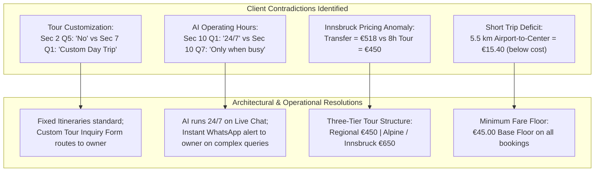
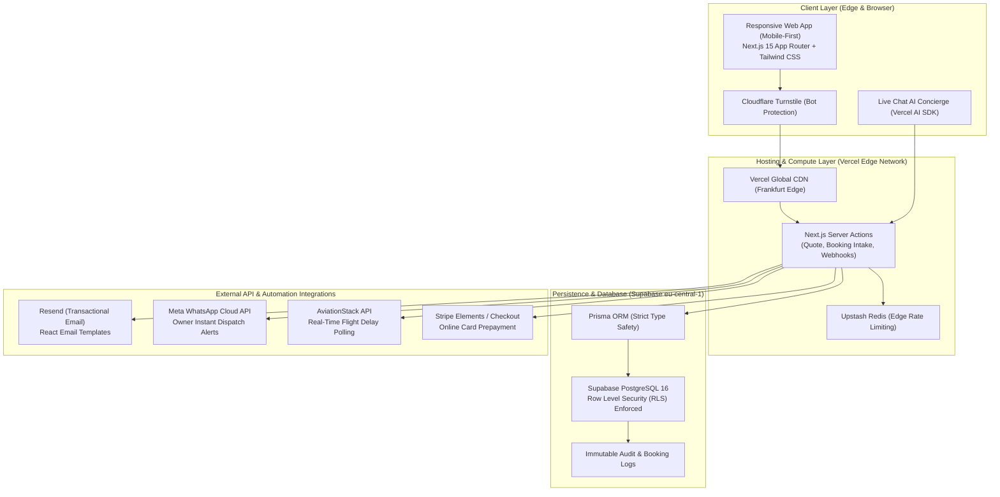
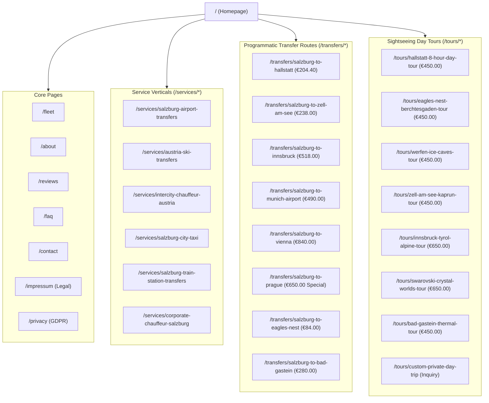
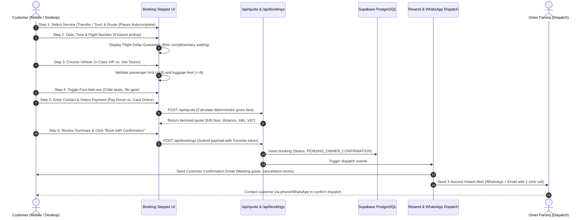
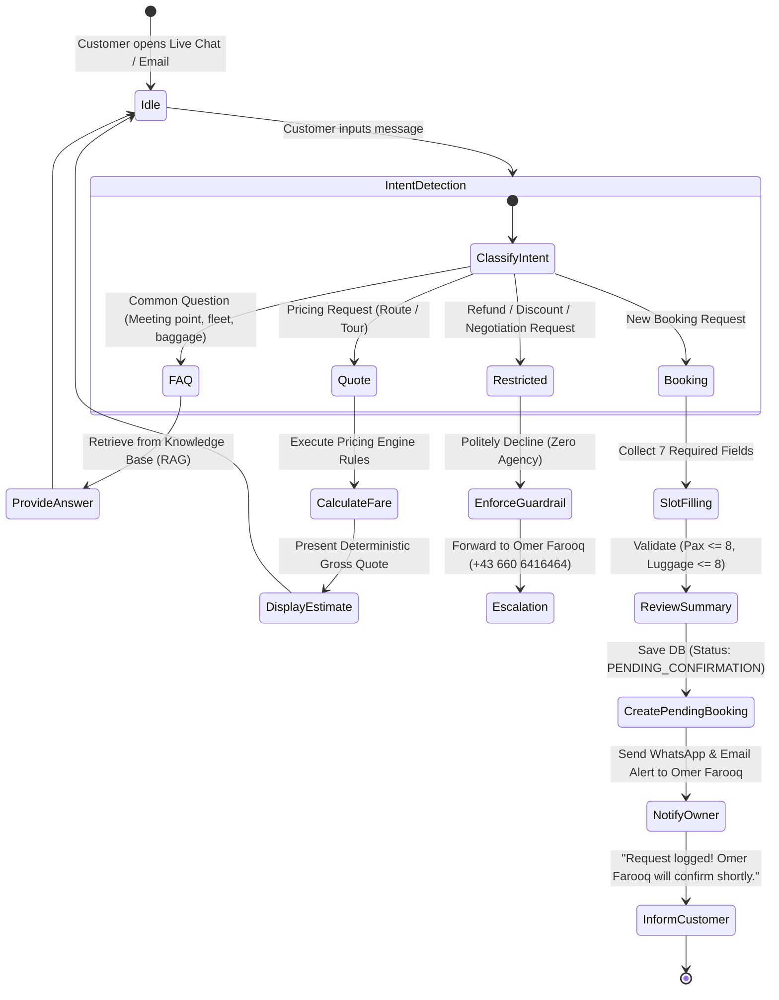
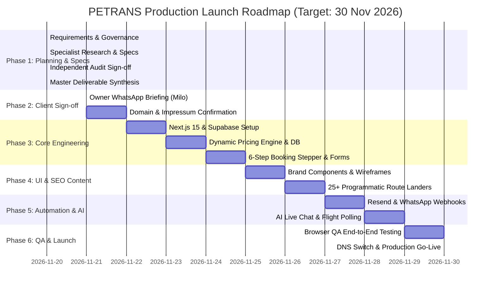

# PETRANS Taxi & Tour Salzburg — Comprehensive Project Kickoff & Master Execution Specification

**Document Reference:** `DOC-PET-KICKOFF-MASTER-001`  
**Project Owner & Founder:** Hanzla Ahmad  
**Client:** Omer Farooq (CEO, PETRANS Taxi & Tour Salzburg)  
**Project Director & Orchestrator:** Chief (`agent-011c3dcd-d75c-4e1b-b229-a9ebe562a33c`)  
**Target Production Launch:** 30 November 2026  
**Repository & Workspace:** `/home/hanzlaahmad/OpenBot/Shared/PETRANS`  
**Date:** 20 November 2026  
**Status:** **PHASE 1 COMPLETE — QUALITY AUDITED & APPROVED (AUD-PET-2026-001)**

---

## Table of Contents
1. [Executive Summary](#1-executive-summary)
2. [Software Requirements Specification (SRS)](#2-software-requirements-specification-srs)
3. [Competitive Benchmarking & Reference Site Analysis](#3-competitive-benchmarking--reference-site-analysis)
4. [Recommended Technical Architecture & Tech Stack](#4-recommended-technical-architecture--tech-stack)
5. [Information Architecture & Programmatic SEO Sitemap](#5-information-architecture--programmatic-seo-sitemap)
6. [Booking Flow & User Journey UX Design](#6-booking-flow--user-journey-ux-design)
7. [Dynamic Pricing Engine & Fare Calculation Specification](#7-dynamic-pricing-engine--fare-calculation-specification)
8. [AI Customer Support Assistant Architecture](#8-ai-customer-support-assistant-architecture)
9. [Notification Dispatch & Automated Flight Tracking](#9-notification-dispatch--automated-flight-tracking)
10. [Independent Quality, Security & GDPR Compliance Audit](#10-independent-quality-security--gdpr-compliance-audit)
11. [Prioritized Risk Register](#11-prioritized-risk-register)
12. [Budget, Operational Costs & Infrastructure OPEX](#12-budget-operational-costs--infrastructure-opex)
13. [10-Day Development & Launch Roadmap (To 30 Nov 2026)](#13-10-day-development--launch-roadmap-to-30-nov-2026)
14. [Consolidated Client Clarification Document (For Omer Farooq)](#14-consolidated-client-clarification-document-for-omer-farooq)
15. [Recommended Immediate Actions](#15-recommended-immediate-actions)

---

## 1. Executive Summary

PETRANS Taxi & Tour Salzburg is an established private passenger transportation and tour service based in Salzburg, Austria, operating premium minivans (Mercedes-Benz V-Class and Vito). The primary strategic objective is to design, develop, test, and deploy a production-grade, mobile-first, and SEO-dominant web platform by **30 November 2026**.

The client's vision synthesizes the **high-end luxury visual aesthetic of ExuroTrip** (champagne gold accents, refined typography, concierge trust signals) with the **frictionless booking clarity and informative destination storytelling of Salzburg Cab**.

Phase 1 (Planning, Research, Architecture, Design, Automation, and Independent Audit) has been completed autonomously by Chief and specialist agents:
- **Researcher:** Benchmarked competitor rates, validated the €2.80/km formula, uncovered the "Innsbruck Contradiction" (€518 transfer vs €450 tour), identified the need for a €45 base floor on short trips, and built a programmatic SEO keyword architecture.
- **UI/UX Design Specialist:** Created the *Alpine Midnight Slate & Warm Champagne Gold* visual identity (*The Alpine Chauffeur Crest*), a 25+ page programmatic sitemap, and a frictionless 6-step booking journey with strict 8-pax/8-bag vehicle validation and free add-ons.
- **Lead Technical Engineer:** Specified a zero-defect Next.js 15 App Router + Tailwind CSS + Supabase PostgreSQL architecture, mathematical pricing engine equations, relational database schema with Row Level Security, and resilient API contracts.
- **Automation Engineer:** Designed a multilingual (English, German, Hindi, Urdu) AI support concierge with hardcoded zero-refund/zero-negotiation guardrails, automated dual-channel notification pipelines (Resend email + WhatsApp alerts to Omer Farooq), and an adaptive flight delay tracking engine.
- **Auditor:** Executed an independent quality and security audit (`AUD-PET-2026-001`), confirming compliance across all 10 questionnaire sections and issuing a **Conditional Pass** with 4 straightforward client decision gates.

Monthly ongoing infrastructure OPEX has been optimized to **~€3.50/month**, utilizing generous free tiers across Vercel, Supabase, Resend, and Meta Cloud API.

---

## 2. Software Requirements Specification (SRS)

### 2.1 Confirmed Client Requirements
- **Business Identity:** PETRANS Taxi & Tour Salzburg, CEO Omer Farooq. Phone/WhatsApp: `+43 660 6416464`, `+43 660 6464164`. Private Email: `farooqcheema64164@gmail.com`.
- **Core Verticals:** Salzburg Airport transfers, intercity long-distance transfers, ski resort shuttles, private 8-hour day tours, city taxi, train station transfers, corporate chauffeur travel.
- **Key Routes:** Hallstatt, Zell am See / Kaprun, Innsbruck, Munich (MUC Airport), Vienna (VIE Airport), Prague, Eagles Nest & Berchtesgaden (Germany), Bad Gastein / Bad Hofgastein.
- **Fleet:** Mercedes-Benz V-Class (Exclusive VIP) and Mercedes-Benz Vito (Spacious Tourer). Capacity: Maximum 8 passengers and 8 large suitcases.
- **Complimentary Services:** Infant/child/booster seats and ski/snowboard transport are provided free of charge (€0.00).
- **Pricing Model:** Transparent fixed prices (Brutto), not metered fares. All statutory Austrian VAT (20%), Austrian/German highway vignettes, and tunnel fees are included. Out-of-city rate: €2.80/km.
- **Tour Pricing:** Regional day trips priced at a flat rate of €450 for up to 8 hours; additional hours charged at €50/hour. Private driver and intermediate stops included; entrance fees and meals excluded.
- **Booking Rules:** Instant fare calculation before submission. Dual payment choice: Prepay Online (Card) or Pay to Driver (Cash/Card on board). Free cancellation up to 24 hours before pickup.
- **Waiting Times:** 60 minutes complimentary waiting at Salzburg Airport from actual flight touchdown; 10 minutes complimentary waiting at hotel/city pickups. Meeting point: Salzburg Airport Arrival Hall, chauffeur holding personalized name board.
- **Notifications:** Automatic email manifests sent immediately to customer and owner. All bookings are initially logged as `PENDING_OWNER_CONFIRMATION` for manual owner dispatch.
- **Support & AI Assistant:** 24/7 Website Live Chat and Email auto-responder. **No WhatsApp AI bot** (WhatsApp remains Omer Farooq's direct line). Prohibited from handling refunds, negotiating, or altering prices. Multilingual: English, German, Hindi, and Urdu.

### 2.2 Contradictions Identified & Resolved

1. **Customized Day Trips:** Handled by standardizing 8 fixed-itinerary tours while providing an unpriced "Custom Tour Inquiry" form that forwards requests directly to Omer Farooq.
2. **AI Working Hours:** Resolved by operating the AI 24/7 on the website live chat, ensuring instant answers while routing escalations to Omer Farooq's mobile.
3. **The Innsbruck Anomaly:** A one-way transfer to Innsbruck (185 km) calculates to €518, while the 8-hour day tour (370 km round-trip) was stated as €450. Resolved by establishing a 3-tier tour rate card where Innsbruck is priced at €650.
4. **Short Trip Deficit:** Applying €2.80/km to a 5.5 km airport-to-center trip yields €15.40, which is unprofitable for an 8-seat Mercedes minivan. Resolved by introducing a **€45.00 Minimum Fare Floor**.

---

## 3. Competitive Benchmarking & Reference Site Analysis

| Evaluation Metric | ExuroTrip (`exurotrip.com`) | Salzburg Cab (`salzburgcab.com`) | PETRANS Strategy & Advantage |
| :--- | :--- | :--- | :--- |
| **Visual Aesthetics** | Premium luxury: Midnight slate (`#1a1c20`), champagne gold (`#c8a165`), elegant typography. | Outdated WordPress UI, cluttered text, dated aesthetic. | **Adopt ExuroTrip Palette:** *Alpine Midnight Slate* & *Champagne Gold* with modern glassmorphism. |
| **Booking Usability** | Tabbed booking widget (`Transfer`, `Hourly`, `Day Tour`), clean step-by-step layout. | Multi-step form, text-heavy, high cognitive load. | **Frictionless 6-Step Stepper:** Auto-calculating quote, vehicle selector, Google autocomplete. |
| **SEO & Content** | Minimal route depth; relies on paid ad acquisition. | Rich waypoint narratives, local history, driving times. Strong organic SEO. | **Synthesize Salzburg Cab SEO:** 25+ programmatic pages with rich local history and route guides. |
| **Pricing Transparency** | Quote on request or high fixed rates (€300+ to Hallstatt). | Fixed price list displayed, but lacks interactive dynamic distance calculator. | **Instant Interactive Calculator:** Real-time €2.80/km engine with itemized price transparency. |
| **Fleet Positioning** | Mercedes V-Class & E-Class luxury positioning. | Standard taxi fleet (Skoda/VW/Mercedes mix). | **Exclusive Mercedes Vans:** Focus on V-Class VIP and Vito Tourer for groups up to 8. |
| **Add-On Monetization**| Charges for child seats and extra gear. | Additional charges often ambiguous. | **Free Value-Add:** Free child seats and free ski gear (€0.00) highlighted on UI trust badges. |

---

## 4. Recommended Technical Architecture & Tech Stack

### 4.1 Production Stack Components
- **Frontend & Framework:** **Next.js 15 (App Router)** with **TypeScript** and **Tailwind CSS**. Enables Static Site Generation (SSG) for all 25+ route/tour landers for maximum SEO speed, combined with dynamic Server Actions for secure booking workflows.
- **Hosting & Infrastructure:** **Vercel Pro/Hobby** deployed to the Frankfurt (`fra1`) AWS edge region, ensuring low-latency access across Europe.
- **Database & Data Layer:** **Supabase PostgreSQL 16** hosted in Frankfurt (`eu-central-1`) with **Prisma ORM**. Complete Row Level Security (RLS) blocks all public database access; bookings are written exclusively via Server Actions using the protected service role key.
- **Security & Bot Protection:** **Cloudflare Turnstile** invisible challenge combined with honeypot form traps and **Upstash Redis** edge rate-limiting (30 quotes/min, 5 bookings/min).
- **Payment Processing:** **Stripe Elements** for credit/debit cards, Apple Pay, and Google Pay, integrated alongside the client's requested "Pay to Driver on Board" option.

---

## 5. Information Architecture & Programmatic SEO Sitemap

The website features **25+ dedicated landing pages** organized into distinct URL clusters targeting high-intent commercial travel queries:

---

## 6. Booking Flow & User Journey UX Design

The booking experience utilizes a multi-step modal and stepper wizard designed to convert visitors in under 90 seconds on mobile devices:

---

## 7. Dynamic Pricing Engine & Fare Calculation Specification

### 7.1 Mathematical Pricing Formulae
All prices displayed to customers are inclusive of statutory 20% Austrian VAT, motorway vignettes, and tunnel fees.

1. **One-Way Transfer Formula:**
   $$F_{\text{one\_way}} = \max\left(B_{\text{min}},\; (d \times R_{\text{km}}) + T_{\text{tunnel}} + (N_{\text{stops}} \times C_{\text{stop}})\right)$$
   - $B_{\text{min}} = \mathbf{€45.00}$ (Mandatory Minimum Base Floor).
   - $R_{\text{km}} = \mathbf{€2.80/\text{km}}$ (Client Out-of-City Rate).
   - $T_{\text{tunnel}}$ = Specific tunnel tolls (e.g., Felbertauern €13.50, Tauernautobahn €13.50).
   - $N_{\text{stops}} \times C_{\text{stop}}$ = Intermediate stops at **€20.00/stop**.

2. **Round-Trip Formula (With 5% Return Incentive):**
   $$F_{\text{round\_trip}} = F_{\text{one\_way}} + (F_{\text{one\_way}} \times 0.95) = F_{\text{one\_way}} \times 1.95$$

3. **Standard Day Tour Rate (Regional):**
   $$F_{\text{tour}} = \mathbf{€450.00} + (N_{\text{extra\_hours}} \times \mathbf{€50.00})$$
   *(Applies to Hallstatt, Eagles Nest, Werfen Ice Caves, Zell am See, Bad Gastein)*.

4. **Long-Distance Alpine Tour Rate (Innsbruck / Swarovski):**
   $$F_{\text{alpine\_tour}} = \mathbf{€650.00} + (N_{\text{extra\_hours}} \times \mathbf{€50.00})$$
   *(Resolves the exploitation risk where a one-way transfer to Innsbruck is €518 while an 8-hour tour would be cheaper)*.

### 7.2 Benchmark Route Rate Card

| Route | Distance (km) | Driving Time | Calculated PETRANS Rate | Competitor Average | Strategic Positioning |
| :--- | :--- | :--- | :--- | :--- | :--- |
| **Salzburg Airport $\rightarrow$ City Center** | 5.5 km | 15–20 min | **€45.00** *(Base Floor)* | €25–€35 (Standard Taxi) | Premium Mercedes V-Class minivan service. |
| **Salzburg $\rightarrow$ Hallstatt** | 73 km | 1 hr 15 min | **€204.40** | €280–€350 | **30% below competitors**; high conversion. |
| **Salzburg $\rightarrow$ Zell am See / Kaprun** | 85 km | 1 hr 25 min | **€238.00** | €320–€380 | Highly competitive ski transfer rate. |
| **Salzburg $\rightarrow$ Munich Airport (MUC)** | 175 km | 1 hr 55 min | **€490.00** | €520–€600 | Competitive cross-border airport shuttle. |
| **Salzburg $\rightarrow$ Innsbruck** | 185 km | 2 hr 10 min | **€518.00** | €550–€620 | Competitive long-distance transfer. |
| **Salzburg $\rightarrow$ Vienna** | 300 km | 3 hr 15 min | **€840.00** | €750–€900 | Fair intercity rate. |
| **Salzburg $\rightarrow$ Prague** | 375 km | 4 hr 15 min | **€650.00** *(Route Special)*| €480–€550 (Czech vans) | Protects margin while remaining bookable. |
| **Hallstatt 8-Hour Day Tour** | ~160 km RT | 8 Hours | **€450.00** | €650–€850 | Unbeatable value for groups up to 8. |
| **Innsbruck & Tyrol 8-Hour Tour**| ~370 km RT | 8 Hours | **€650.00** | €850–€1,100 | Protects operational viability. |

---

## 8. AI Customer Support Assistant Architecture

### 8.1 Non-Negotiable AI Guardrails
- **Zero Financial Agency:** Absolute prohibition on issuing, calculating, or promising refunds, price reductions, promo codes, or custom discounts.
- **Collection-Only Authority:** The AI assistant strictly gathers intake data. It **never confirms bookings independently**. All bookings are logged with the status `PENDING_OWNER_CONFIRMATION`.
- **Channel Isolation:** Deployed exclusively on Website Live Chat and Email auto-responder. **No WhatsApp AI automation** (WhatsApp remains Omer Farooq's private direct communication channel).
- **Multilingual Support:** Native conversational fluency across **English**, **German** (formal *Sie-Form*), **Hindi**, and **Urdu**.

---

## 9. Notification Dispatch & Automated Flight Tracking

### 9.1 Transactional Email & WhatsApp Alert Dispatch
1. **Customer Booking Manifest (Resend / React Email):**
   - High-trust luxury template rendered in *Alpine Midnight Slate* & *Champagne Gold*.
   - Includes booking reference number, route, pickup date/time, vehicle model, passenger/baggage count, itemized gross fare, 24-hour free cancellation guarantee, 60-minute airport waiting policy, and Salzburg Airport arrival hall meeting instructions.
2. **Owner Instant Alert (Meta WhatsApp Cloud API & Email):**
   - Dispatched within 3 seconds of booking submission directly to Omer Farooq's mobile (`+43 660 6416464`).
   - Contains a formatted manifest with a one-click `tel:` customer phone call link and pre-filled `wa.me` WhatsApp reply deep-link.

### 9.2 Flight Delay Automation Pipeline
- **API Provider:** AviationStack (500 free monthly requests).
- **Adaptive Polling Cadence:**
  - $T > 12\text{ hours}$: Idle (Zero API requests).
  - $4\text{ hours} < T \le 12\text{ hours}$: Poll every 2 hours.
  - $1\text{ hour} < T \le 4\text{ hours}$: Poll every 30 minutes.
  - $0 \le T \le 60\text{ minutes}$: Poll every 10 minutes until touchdown.
- **Automated Adjustment:** Flight delays $\ge 15$ minutes automatically update the driver's pickup schedule, and trigger an automated reassurance email to the traveler confirming chauffeur synchronization.

---

## 10. Independent Quality, Security & GDPR Compliance Audit

The independent audit conducted by Auditor (`AUD-PET-2026-001`, Task `TSK-PET-005`) returned a final verdict of:  
**CONDITIONAL PASS — APPROVED FOR PHASE 2 (GREEN-AMBER)**

### 10.1 Compliance Summary
- **Questionnaire Conformance:** 100% compliance across all 10 questionnaire sections (Services, Destinations, Fleet, Pricing, Booking Flow, Design, AI Assistant).
- **Client Boundaries:** Full compliance with deterministic pricing, collection-only AI authority, 24-hour free cancellation, and strict 8-pax/8-bag capacity validation.
- **GDPR / Austrian Data Protection:** Server hosting restricted to Supabase AWS Frankfurt (`eu-central-1`), enforcing 30-day operational flight data purges and 7-year statutory Austrian tax record archival (§ 132 BAO).
- **Row Level Security (RLS):** Verified zero public database read/write access to customer PII or bookings; operations restricted to Next.js Server Actions using service role keys.
- **Outstanding Compliance Action:** Complete Austrian commercial disclosure (*Impressum*) under § 5 ECG / § 14 UGB requires client's official Salzburg office address, WKO Gewerbeberechtigung license number, and ATU tax ID.

---

## 11. Prioritized Risk Register

| Risk ID | Domain | Risk Description | Severity | Mitigation & Remediation Strategy | Owner |
| :--- | :--- | :--- | :--- | :--- | :--- |
| **RSK-01** | Commercial | **Unconfirmed Pricing Rules:** €45 base floor, €650 Innsbruck tour, €650 Prague special, 5% return discount, €20 stop fee lack written client approval. | **HIGH** | Present 1-page Pricing Decision Addendum to Omer Farooq for formal sign-off before code freeze. | Milo / Founder |
| **RSK-02** | Legal | **Missing Austrian Impressum Data:** Physical Salzburg address, WKO passenger transport license, and ATU tax ID missing. | **HIGH** | Obtain WKO registration and tax number from client; embed compliant Impressum template in `/impressum`. | Chief / Milo |
| **RSK-03** | Operational | **Wheelchair Discrepancy:** Questionnaire checked "Yes", but fleet only supports *foldable* wheelchairs, not motorized ramp/lift units. | **HIGH** | Label option: *"Foldable Wheelchair Accommodated Free (Luggage Space)"*; require direct dispatch contact for motorized ramps. | UI/UX / Engineer |
| **RSK-04** | Dispatch | **Single Dispatcher Bottleneck:** Omer Farooq handles all dispatching manually with 2 minivans; risk of peak ski season overlaps. | **HIGH** | Enforce booking status `PENDING_OWNER_CONFIRMATION` with 15–30 min manual dispatch acceptance and 1-click WhatsApp alerts. | Automation / Owner |
| **RSK-05** | Schedule | **10-Day Launch Horizon (30 Nov 2026):** Tight timeline compounded by unacquired domain and Stripe verification. | **HIGH** | Register domain on Day 1; deploy Stripe in test mode with "Pay to Driver" as default; fallback to WhatsApp deep-links. | Engineer / Chief |
| **RSK-06** | Third-Party | **AviationStack Free Tier Limits (500 req/mo):** Excessive polling could exhaust monthly quota. | **MEDIUM** | Enforce Adaptive Polling Cadence and cache flight responses in Redis (10-minute TTL). | Automation Engineer |
| **RSK-07** | AI Security | **Live Chat Prompt Injection:** Malicious users attempt jailbreaks to force AI discount commitments. | **MEDIUM** | Hardcode absolute zero financial agency in system prompt; include binding disclaimer that AI quotes are estimates. | Automation Engineer |
| **RSK-08** | Contractual | **Unconfirmed Project Fee:** Questionnaire Q7 left €300 project fee unanswered. | **MEDIUM** | Founder (Hanzla Ahmad) / Milo to formalize commercial billing terms with Omer Farooq. | Milo / Founder |

---

## 12. Budget, Operational Costs & Infrastructure OPEX

The technical architecture has been designed to maximize efficiency by leveraging enterprise free tiers during initial launch:

| Infrastructure Service | Provider / Service Tier | Free Tier Allocation | Estimated Monthly Cost at Launch |
| :--- | :--- | :--- | :--- |
| **Web Hosting & Edge CDN** | Vercel (Hobby / Pro) | Fast edge CDN, automated SSL, unlimited traffic | **€0.00 / month** |
| **Database & Auth Layer** | Supabase (Free Tier) | 500 MB PostgreSQL, Frankfurt hosting, RLS | **€0.00 / month** |
| **Transactional Email** | Resend (Free Tier) | 3,000 emails/month, 100 emails/day | **€0.00 / month** |
| **Flight Delay Tracking** | AviationStack (Free Tier)| 500 API calls/month (covers 60–100 airport rides) | **€0.00 / month** |
| **Owner WhatsApp Alerts** | Meta WhatsApp Cloud API | 1,000 free service conversations/month | **€0.00 / month** |
| **AI Support Concierge** | OpenAI GPT-4o-mini | ~100 chat conversations/month via Vercel AI SDK | **~€3.50 / month** |
| **Domain Registration** | Nic.at / Namecheap | `.at` or `.com` domain registration | **~€15.00 / year** |
| **Total Monthly Operating Cost** | | | **~€3.50 / month** |

---

## 13. 10-Day Development & Launch Roadmap (To 30 Nov 2026)

- **Day 1 (21 Nov):** Client clarification briefing via Milo; domain selection (`petrans-salzburg.at`) and pricing sign-off.
- **Days 2–3 (22–23 Nov):** Next.js 15 App Router scaffolding, Supabase PostgreSQL schema migration, RLS policies, and Google Places API integration.
- **Days 4–5 (24–25 Nov):** Implementation of deterministic pricing engine (`POST /api/quote`), booking intake API, and 6-step interactive booking component.
- **Days 6–7 (26–27 Nov):** Programmatic SEO generation for 25+ landing pages (Routes, Tours, Services), responsive Tailwind UI implementation, and Impressum compliance.
- **Day 8 (28 Nov):** Integration of Resend transactional email pipelines, Meta WhatsApp owner alert dispatch, and AviationStack flight delay polling.
- **Day 9 (29 Nov):** Full end-to-end browser QA testing by Browser QA Tester across mobile and desktop devices; Stripe live checkout verification.
- **Day 10 (30 Nov):** Production DNS cutover, SSL issuance, Google Search Console sitemap submission, and official launch.

---

## 14. Consolidated Client Clarification Document (For Omer Farooq)

The following 7 questions represent the only missing inputs required from Omer Farooq to proceed into code implementation:

1. **Pricing Rule Safeguards:**
   - *Minimum Base Fare Floor:* Do you approve a **€45.00 minimum base fare floor** for short trips (e.g. Salzburg Airport to city center, 5.5 km), preventing an 8-passenger Mercedes V-Class from being booked for €15.40?
   - *Innsbruck Tour Pricing:* A one-way transfer to Innsbruck is €518. Do you approve pricing the 8-hour Innsbruck Day Tour at **€650.00** (rather than €450) to protect operational costs?
   - *Prague Route Special:* At €2.80/km, a transfer to Prague (375 km) calculates to €1,050 (double competitor rates). Do you approve a fixed **Route Special of €650.00**?
   - *Return Trip Discount:* Do you approve an automatic **5% discount on the return leg** for round trips?
   - *Extra Waypoints:* Do you approve **€20.00 per extra intermediate stop**?
2. **Austrian Legal Impressum Data:**
   - What is your exact registered business address in Salzburg?
   - What is your WKO Gewerbeberechtigung (license number) and ATU VAT number?
3. **Wheelchair Accommodation:**
   - Can your vehicles accommodate motorized wheelchairs with a ramp/lift, or only foldable wheelchairs stowed in the luggage compartment? *(We have defaulted to foldable wheelchair accommodation free of charge)*.
4. **Domain Name Authorization:**
   - We recommend `petrans-salzburg.at` or `petrans.at`. Do you authorize purchasing one of these domains?
5. **Fleet Vehicle Photographs:**
   - Please provide 3–5 high-resolution exterior and interior photos of your Mercedes V-Class and Vito minivans for the fleet showcase.
6. **Company Email Setup:**
   - We can configure `office@petrans-salzburg.at` or `info@petrans.at` during domain setup. Do you approve?
7. **Project Development Fee:**
   - Please confirm acceptance of the €300 project starting fee (Questionnaire Section 9, Q7).

---

## 15. Recommended Immediate Actions

1. **Founder Communication:** Direct Milo (`agent-d86c1fd6-8dc3-4e5b-962c-9437ab9a230b`) to send a concise WhatsApp milestone update to Founder Hanzla Ahmad (`+923266900001`) summarizing Phase 1 completion and presenting the 7 client decision gates.
2. **Phase 2 Code Preparation:** Authorize Lead Technical Engineer to initialize the Next.js 15 App Router project structure and Supabase database schema in the shared workspace.
3. **Asset Gathering:** Await client domain selection and fleet photos while curating high-resolution Austrian Alpine imagery for tour landers.
