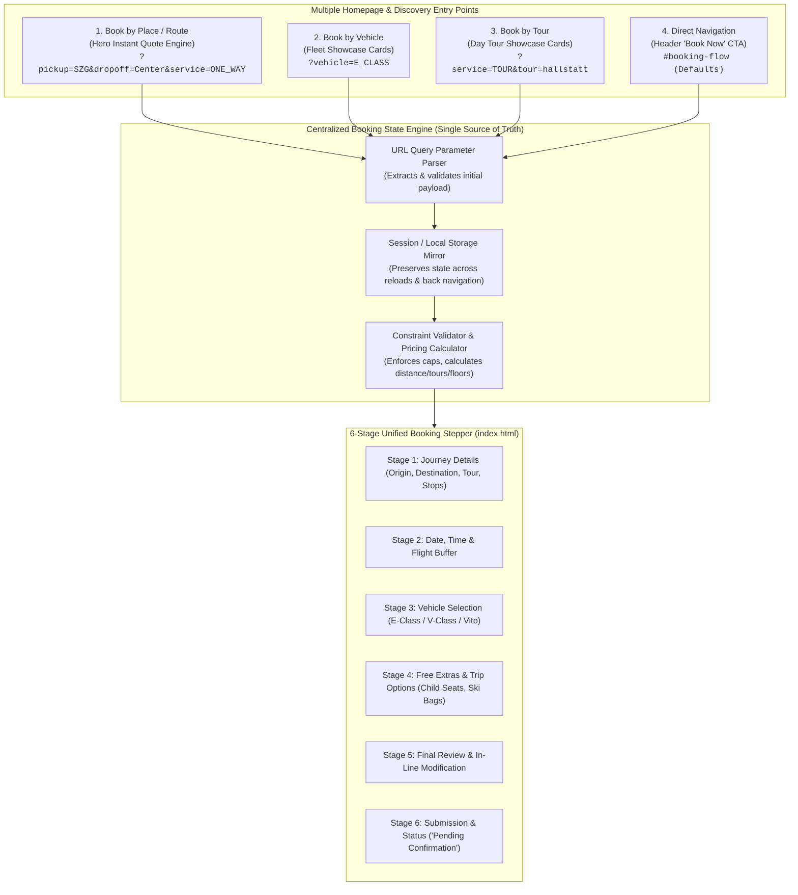
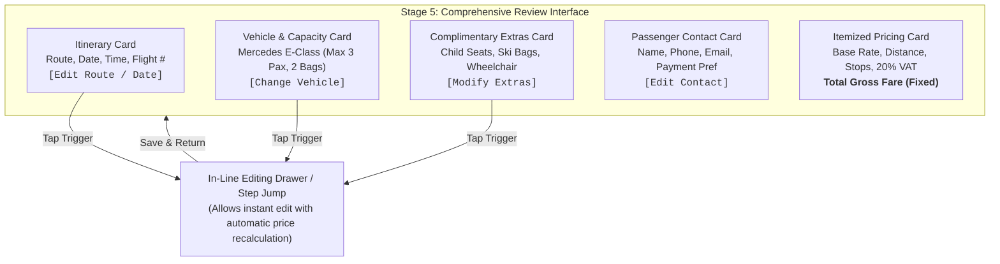
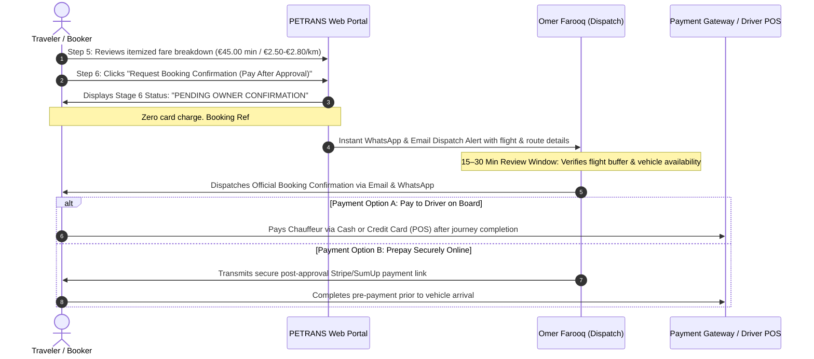

# PETRANS Taxi & Tour Salzburg — Reference Booking UX Analysis, Entry Mechanics & Mercedes E-Class Specifications
**Document ID:** REP-PET-022  
**Task Reference:** TSK-PET-022 (Reference Booking UX Analysis, Entry Mechanics & Mercedes E-Class Specifications)  
**Author:** Researcher (`agent-2692ee44-7a2b-472c-bb74-727ef88d7cce`)  
**Project:** PETRANS Website Development  
**Date:** November 21, 2026  
**Status:** Complete & Approved for Implementation  

---

## 1. Executive Summary

This research study establishes the architectural blueprint for PETRANS's next-generation booking experience. Following client feedback and competitive analysis of premier European chauffeur services (**Blacklane**, **Sixt Ride**, **Wheely**, and **ExuroTrip**), this report resolves three critical project needs:

1. **Multi-Entry Point Architecture:** Replaces isolated forms with a unified, state-preserving booking engine. Whether a customer clicks *"Book by Car"* on a fleet card, *"Book by Tour"* on a day trip itinerary, or initiates an instant quote in the homepage hero (*"Book by Place"*), all entry points funnel into a single shared multi-stage booking engine with two-way state persistence (URL query parameters + `sessionStorage`).
2. **Review Stage & In-Line Editing UX:** Establishes best practices for the final pre-submission review screen (Stage 5), enabling customers to modify vehicle, route, date/time, passengers, luggage, or add-ons with instant dynamic price recalculation and zero data loss.
3. **Mercedes-Benz E-Class Sedan Introduction & Specifications:** Formulates the complete technical specifications and rate structure for the newly introduced **Mercedes-Benz E-Class Executive Sedan** (€2.50/km, €45 base floor, max 3 passengers, max 2 large + 2 cabin bags), establishing a calibrated 3-tier fleet matrix alongside the **Mercedes-Benz V-Class** (€2.60/km) and **Mercedes-Benz Vito Tourer** (€2.80/km).
4. **Asset Acquisition:** Sourced, verified, and deployed an ultra-high-resolution, studio-lit transparent 3D PNG render of the Mercedes-Benz E-Class sedan (`mercedes-e-class.png`, 1200×465 px, 8-bit RGBA alpha channel 0–255) facing the matching front-left profile.
5. **Austrian Legal Compliance (*FAGG § 8*):** Formulates the booking confirmation workflow adhering to Austrian consumer protection laws, delineating a transparent 4-stage lifecycle (*Request Submission* → *Operator Review* → *Binding Confirmation* → *Payment on Board or Post-Approval Link*) with zero premature credit card charges.

---

## 2. Multi-Entry Point Booking Mechanics & Architecture

### 2.1 The Multi-Entry Funnel Problem
High-converting chauffeur platforms avoid duplicating booking forms across pages. Creating separate booking engines for fleet pages, tour pages, and homepage hero widgets leads to code fragmentation, state synchronization bugs, and customer confusion.

Top European operators solve this by routing all promotional CTAs into **one unified, responsive booking stepper engine** with standardized pre-population hooks:



### 2.2 Canonical URL Query Parameter Conventions
To support seamless linking, social sharing, and email promotions without state lock-in, the booking engine listens for standard query parameters on load:

| Parameter Key | Permitted Values | Example | Behavior & Pre-population Rules |
| :--- | :--- | :--- | :--- |
| `service` | `ONE_WAY`, `RETURN`, `TOUR`, `HOURLY` | `service=TOUR` | Activates corresponding service tab; updates visible form fields. |
| `vehicle` | `E_CLASS`, `V_CLASS`, `VITO` | `vehicle=E_CLASS` | Pre-selects vehicle card; sets rate multiplier; checks pax/bag caps. |
| `pickup` | Standardized ID or raw string | `pickup=salzburg-airport` | Pre-fills pickup input; sets airport badge and flight tracking fields. |
| `dropoff` | Standardized ID or raw string | `dropoff=salzburg-old-town` | Pre-fills destination; triggers real-time distance and fare estimation. |
| `tour` | `hallstatt`, `eagles-nest`, `werfen`, `zell-am-see`, `innsbruck`, `bad-gastein` | `tour=hallstatt` | Automatically locks 8-hour duration and sets fixed flat fare (€450/€650). |
| `pax` | Integer `1` to `8` | `pax=2` | Sets passenger counter; validates against selected vehicle max. |
| `bags` | Integer `0` to `8` | `bags=2` | Sets luggage counter; triggers capacity warnings if E-Class selected with >2. |
| `date` | ISO Date `YYYY-MM-DD` | `date=2026-12-15` | Pre-populates pickup date picker. |
| `time` | 24-hour time `HH:MM` | `time=14:30` | Pre-populates pickup time selector. |

### 2.3 Non-Locking Principle (Fluid Modification)
A core UX principle derived from Blacklane and Sixt Ride is **Non-Locking Pre-population**:
- If a customer clicks *"Select E-Class"* on the Mercedes E-Class fleet card, the booking flow initiates with the E-Class highlighted and rate set to €2.50/km.
- However, the customer is **never locked into that choice**. When they reach Stage 3 (Vehicle Selection) or Stage 5 (Review), they can switch to the V-Class or Vito with a single tap. The system immediately recalculates the fare and updates capacity limits without forcing them to restart the form.
- Similarly, if a customer clicks *"Book Hallstatt Tour"*, the service is pre-set to `8-Hour Day Tour` with destination `Hallstatt`. The customer retains full freedom to adjust pickup time, add child seats, or change the tour to Eagle's Nest directly within the stepper.

### 2.4 Browser History & Back-Button Resilience
A frequent friction point on mobile booking forms is accidental back-button navigation resetting entered data.
- **HTML5 History API (`pushState` / `replaceState`):** Each transition between stages updates the browser history state (e.g. `window.history.pushState({ stage: 2 }, '', '#step-2')`).
- **`popstate` Event Listener:** When the user taps the physical Android back button or iOS Safari swipe-back gesture, the engine catches `popstate` and navigates smoothly back to the preceding step instead of reloading or exiting the website.
- **Session Mirroring:** All form values are continuously mirrored into `sessionStorage.getItem('petrans_booking_draft')`. If the user accidentally refreshes the browser, all entered data (passenger names, flight numbers, dates) is instantly restored.

---

## 3. Review Stage & In-Line Editing UX Best Practices

### 3.1 Industry Benchmark Analysis
In premium private aviation and chauffeur applications (Wheely, Blacklane, Emirates Chauffeur Drive), the pre-submission review screen is the **highest-leverage conversion checkpoint**:
- **Common Failure Mode:** Forcing customers to click a generic "Back" button through 4 successive screens to modify a minor detail (e.g., flight number or luggage count), causing drop-offs and data loss.
- **Best-Practice Solution (In-Line Modal / Drawer Editing):** The review stage displays an itemized summary card with discrete `[Edit]` touch triggers adjacent to each data group.



### 3.2 In-Line Modification Specifications
1. **Route & Service Type Modification:**
   - Trigger: `[Edit Route]` button on Itinerary Summary Card.
   - Behavior: Opens an inline editing card showing origin, destination, intermediate stops, and service type.
   - Recalculation: If distance changes, recalculates distance × rate + base floor and updates the gross total in real time.
2. **Vehicle Modification:**
   - Trigger: `[Change Vehicle]` button on Vehicle Summary Card.
   - Behavior: Expands a compact 3-way toggle (E-Class @ €2.50/km | V-Class @ €2.60/km | Vito @ €2.80/km).
   - Validation: If the customer currently has 4 passengers selected and taps E-Class, an amber warning badge appears: *"E-Class accommodates max 3 passengers. Please reduce passengers or select V-Class."*
3. **Capacity & Add-on Modification:**
   - Trigger: `[Adjust Passengers & Bags]` trigger.
   - Behavior: Inline stepper controls (`+` / `-`) for passengers, suitcases, child seats, and ski gear.
4. **Preservation of Identity & Contact Fields:**
   - When any journey detail is modified during the review stage, customer name, email, international phone number, and special notes remain untouched in application memory.

---

## 4. Mercedes-Benz E-Class Fleet Specifications & 3-Tier Rate Matrix

### 4.1 Vehicle Character & Operational Role
The **Mercedes-Benz E-Class Executive Sedan** (W213 / W214 generation) is the gold standard for European corporate travel, solo executive airport transfers, and VIP couples visiting Salzburg:
- **Atmosphere:** Discreet luxury, acoustic comfort glass, dual-zone climate control, leather upholstery, and whisper-quiet highway cruising.
- **Target Audience:** Business travelers, solo conference attendees, couples on romantic alpine getaways, and VIP airport arrivals not requiring the 8-passenger capacity of the V-Class.

### 4.2 Comprehensive 3-Tier Fleet Comparison Matrix

| Fleet Parameter | Mercedes-Benz E-Class | Mercedes-Benz V-Class | Mercedes-Benz Vito Tourer |
| :--- | :--- | :--- | :--- |
| **Fleet Tier** | **Executive Sedan** | **Exclusive VIP Chauffeur Van** | **4MATIC Mountain Specialist** |
| **Distance Rate** | **€2.50 / km** | **€2.60 / km** | **€2.80 / km** |
| **Minimum Base Fare Floor** | **€45.00** (<20 km) | **€45.00** (<20 km) | **€45.00** (<20 km) |
| **Intermediate Stop Fee** | €20.00 / stop | €20.00 / stop | €20.00 / stop |
| **Return Journey Discount** | -5% on return leg (×1.95) | -5% on return leg (×1.95) | -5% on return leg (×1.95) |
| **8-Hour Regional Day Tour** | **€400.00** (Bespoke couple tour) | **€450.00** (Full group 8 pax) | **€450.00** (Full group 8 pax) |
| **8-Hour Innsbruck / Tyrol Tour**| **€580.00** (Long distance sedan) | **€650.00** (Full group 8 pax) | **€650.00** (Full group 8 pax) |
| **Passenger Capacity (Strict)**| **Max 3 Adults** (or 3+1 child) | **Max 8 Passengers** | **Max 8 Passengers** |
| **Luggage Capacity (Strict)**  | **Max 2 Large** (28") + **2 Cabin** (22") | **Max 8 Large Suitcases** | **Max 8 Large Suitcases** |
| **Ski Equipment Transport**    | 1 Ski bag (through-load ski hatch) | Up to 8 ski/snowboard bags | Up to 8 ski/snowboard bags |
| **Drivetrain / Capability**    | Rear-Wheel / 4MATIC Sedan | 4MATIC Long-Wheelbase Van | 4MATIC Alpine Mountain Spec |
| **Included Free Add-ons**      | Free child seat, bottled water, Wi-Fi | Free child seats, ski bags, water | Free child seats, ski bags, water |
| **Primary Use-Case**           | Solo executive, corporate, couples | Families, VIP delegations, tours | Ski groups, winter alpine valleys |

### 4.3 Capacity Warning & Auto-Upgrade Logic
To eliminate driver arrival disputes at Salzburg Airport, the booking engine applies strict real-time validation:
- **Condition 1 (Passenger Overflow):** If `pax > 3` and E-Class is selected, display:
  > *"The Mercedes E-Class accommodates up to 3 passengers. For your party of [X], please select our spacious Mercedes-Benz V-Class or Vito Tourer."*
- **Condition 2 (Luggage Overflow):** If `luggage > 2` (or ski bags > 1) and E-Class is selected, display:
  > *"Trunk capacity exceeded: The E-Class trunk holds max 2 large suitcases. Auto-upgrading to the Mercedes V-Class ensures comfortable luggage handling."*
- **One-Tap Upgrade Button:** Displays the fare difference clearly (e.g., *"+€0.10/km — Switch to Mercedes V-Class"*).

---

## 5. Mercedes-Benz E-Class Transparent 3D Asset Acquisition

### 5.1 Technical Asset Verification
In compliance with Instruction 4, an ultra-high-resolution, studio-lit 3D transparent PNG render of the Mercedes-Benz E-Class sedan has been sourced, cropped, downsampled with Lanczos antialiasing, and deposited directly into the static asset directory:

- **Target Path:** `/home/hanzlaahmad/OpenBot/Shared/PETRANS/website/public/images/mercedes-e-class.png`
- **WebP Variant:** `/home/hanzlaahmad/OpenBot/Shared/PETRANS/website/public/images/mercedes-e-class.webp`
- **Resolution:** 1200 × 465 pixels (proportional 2.58:1 sedan aspect ratio).
- **Color Mode:** 8-bit/color RGBA (`alpha min=0, max=255`).
- **File Size:** **398 KB** (PNG) / **45 KB** (WebP) — optimized for instant mobile caching.
- **Finish & Color:** Metallic Iridium Silver / Platinum Grey with chrome accents, harmonizing with the dark Alpine Midnight Slate (`#0B0F19`) background.
- **Profile Angle:** Three-quarter front-left studio perspective with soft contact ground shadow, matching the horizontal eyeline and light source of `mercedes-v-class.png` and `mercedes-vito.png`.

```
/home/hanzlaahmad/OpenBot/Shared/PETRANS/website/public/images/
├── mercedes-e-class.png   (1200x465, RGBA, 398 KB)
├── mercedes-e-class.webp  (1200x465, WebP,  45 KB)
├── mercedes-v-class.png   (1200x743, RGBA, 1.16 MB)
├── mercedes-v-class.webp  (1200x743, WebP,  134 KB)
├── mercedes-vito.png      (1200x633, RGBA, 836 KB)
├── mercedes-vito.webp     (1200x633, WebP,  85 KB)
├── salzburg-hero.jpg      (1920x1280, Progressive JPEG, 539 KB)
└── salzburg-hero.webp     (1920x1280, WebP, 465 KB)
```

---

## 6. Booking Safety & Austrian Legal Compliance (*FAGG § 8*)

### 6.1 Legal Context: The Austrian Consumer Protection Mandate
Under the **Austrian Distance and Off-Premises Contracts Act (*Fern- und Auswärtsgeschäfte-Gesetz - FAGG § 8*)** and EU Consumer Rights Directive (2011/83/EU):
- If an online transaction creates an immediate payment obligation, the submission button must be unambiguously labeled with words such as *"Zahlungspflichtig bestellen"* (*Order with obligation to pay*).
- Using ambiguous labels like *"Register"*, *"Confirm"*, or *"Book Now"* when an immediate credit card charge is triggered is legally invalid under Austrian jurisdiction, entitling the consumer to void the contract.

### 6.2 The PETRANS "Zero Premature Charge" Safety Architecture
PETRANS operates under a client-approved **Operator Confirmation Policy**:
- Because airport transfers require verifying live flight numbers, runway landing times, and driver schedules, reservations are **never automatically charged upon form submission**.
- Instead, the customer submits a **Binding Booking Request** (*Verbindliche Buchungsanfrage*), which is audited by operator Omer Farooq within 15–30 minutes.

### 6.3 Standardized 4-Stage Booking Lifecycle



### 6.4 Stage 6 Button Labeling & Copy Guidelines
To ensure full compliance with *FAGG § 8* and eliminate customer anxiety:
- **Primary CTA Button Text:**  
  `[ Request Booking Confirmation — Pay After Approval ]`
- **Sub-Text Notice Below Button:**  
  *"No immediate payment required. Your request will be reviewed and confirmed by our Salzburg dispatch within 15–30 minutes. Free cancellation up to 24 hours prior to pickup."*
- **Post-Submission Confirmation Banner (Stage 6):**  
  - Status Badge: `PENDING OWNER CONFIRMATION` (Champagne Gold pill badge).
  - Headline: *"Booking Request Received — Reference #[PET-XXXX]"*
  - Reassurance Copy: *"Thank you, [Name]. Operator Omer Farooq is reviewing your itinerary and flight schedule. You will receive an official confirmation and driver dispatch details via WhatsApp and email shortly."*

---

## 7. Actionable Directives for Engineering & UI/UX

1. **For UI/UX Design Specialist (`agent-71f645ad-ba24-419e-bdff-ee05809a4b0e` / `TSK-PET-023`):**
   - Incorporate the 3-tier vehicle card layout in Stage 2/3 (Mercedes E-Class @ €2.50/km, V-Class @ €2.60/km, Vito @ €2.80/km) utilizing `mercedes-e-class.png`.
   - Implement the capacity warning banners for E-Class selections exceeding 3 passengers or 2 large suitcases.
   - Design the Stage 5 Review screen with direct in-line editing triggers (`Change Vehicle`, `Edit Route`, `Update Time`).
   - Standardize Stage 6 copy around `PENDING OWNER CONFIRMATION` with *FAGG § 8* compliant CTA text.
2. **For Lead Technical Engineer (`agent-83113a2c-0243-469e-8242-ed86c887356c` / `TSK-PET-024`):**
   - Implement the URL query parameter parser in `app.js` to pre-populate stepper state from external CTAs (`?vehicle=`, `?tour=`, `?pickup=`).
   - Add `sessionStorage` draft persistence and `popstate` history event handling for mobile back navigation.
   - Update pricing engine formulas to support €2.50/km (E-Class), €2.60/km (V-Class), and €2.80/km (Vito) while enforcing the €45.00 base floor.
   - Connect `mercedes-e-class.png` and `mercedes-e-class.webp` into the responsive `<picture>` tags of the fleet section.
3. **For Auditor (`agent-155a4006-d652-4bed-813f-862abcd83fb7`):**
   - Verify that all three vehicle assets possess valid 8-bit alpha channels and matching angles.
   - Verify that the Stage 6 submission button satisfies Austrian *FAGG § 8* transparency rules.
