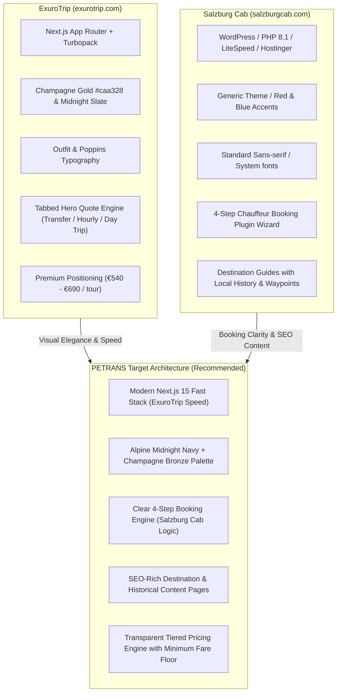
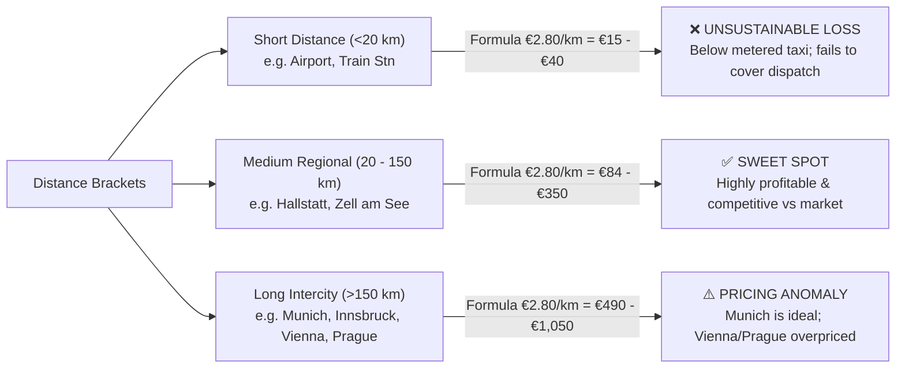
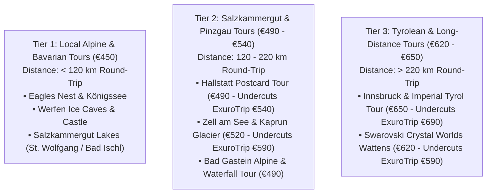
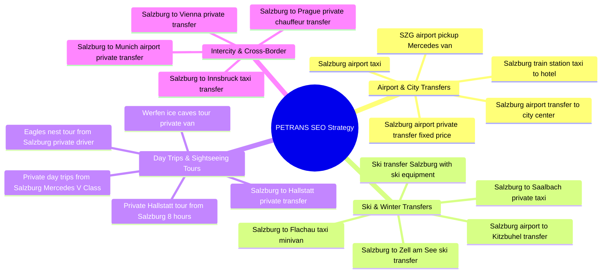

# PETRANS Taxi & Tour Salzburg — Competitor Benchmarking & Market Research Analysis

**Document ID:** `RES-PET-001`  
**Date:** 20 November 2026  
**Author:** Researcher (Senior Market Intelligence & Competitive Strategy)  
**Assigned Task:** `TSK-PET-001`  
**Target Entity:** PETRANS Taxi & Tour Salzburg (CEO: Omer Farooq)  
**Primary Reference Sources:**  
- `exurotrip.com` (Live Production Inspection & Next.js Asset Audit)  
- `salzburgcab.com` (Live Production Inspection & WordPress System Audit)  
- `/home/hanzlaahmad/OpenBot/Shared/PETRANS/docs/requirements_analysis.md`  
- `/home/hanzlaahmad/OpenBot/Shared/PETRANS/docs/questionnaire_extracted.txt`  
- Regional Market Rates: WKO Salzburg Taxi Tariff, Welcome Pickups, MyTransfers, Daytrip, Kiwitaxi, Alps2Alps, Panorama Tours, Salzburg Top Tours, Be Special Tours, Viator/GetYourGuide  

---

## 1. Executive Summary & Market Landscape

PETRANS Taxi & Tour Salzburg is entering a highly lucrative yet competitive alpine transport and private tourism market centered around Salzburg W. A. Mozart Airport (SZG) and the surrounding Salzkammergut, Bavarian Alps, and Tyrolean ski regions.

The client's strategic vision—articulated in the kickoff questionnaire—is to synthesize the **"Premium feel of ExuroTrip with the Simple Booking clarity of Salzburg Cab"** while competing aggressively on **price and vehicle flexibility** utilizing a dedicated Mercedes-Benz fleet (V-Class and Vito, accommodating up to 8 passengers with 8 large suitcases).

### Key Strategic Findings:
1. **The Luxury Perception Gap:** ExuroTrip achieves its premium pricing power (€540–€690 per day tour) through modern design execution: a Next.js 14/15 web application utilizing an Alpine Champagne Gold (`#caa328` / `#c8a165`) and Midnight Charcoal (`#1a1c20`) color palette, geometric typography (`Outfit` / `Poppins`), instant multi-tab quote calculators, and high-trust authority badges (Austrian Certified Guides, Snow-Trained Chauffeurs). In contrast, Salzburg Cab runs an older, bloated WordPress installation (LiteSpeed/PHP 8.1 with 13+ active plugins including Chauffeur Booking System and WooCommerce) that suffers from visual clutter and broken iframe warnings, but succeeds in organic search due to rich destination-specific historical and cultural content.
2. **The Flaw in the Flat €2.80/km Formula:** Applying a flat €2.80/km rate across all distances creates dangerous edge cases:
   - **Severe Underpricing on Short Trips:** A transfer from Salzburg Airport to Salzburg City Center (~5.5 km) calculates to **€15.40**, which is below even the basic metered taxi tariff (€20–€25) and catastrophic for an 8-passenger luxury Mercedes V-Class (market rate: €40–€55). **PETRANS must implement a minimum base fare safeguard (€45–€50).**
   - **Extreme Value on Mid-Range Routes:** For Salzburg to Hallstatt (73 km = €204.40) and Zell am See (85 km = €238.00), PETRANS beats market competitors (€280–€380) by 25–35%, offering an unbeatable value proposition for families and ski groups.
   - **Overpricing on Long Intercity Routes:** For Salzburg to Prague (375 km = €1,050.00), PETRANS is roughly double the prevailing cross-border market rate (€470–€550), which will severely suppress conversion unless tiered distance brackets or flat route rates are deployed.
3. **The "Innsbruck Tour Contradiction" (€450 Tour vs €518 Transfer):** PETRANS proposed a flat €450 for all 8-hour day trips. However, a one-way transfer to Innsbruck (185 km at €2.80/km) costs **€518**, while an 8-hour round-trip tour to Innsbruck (370 km round-trip + 8 hours driver disposal) would cost only **€450**. This creates an immediate exploitation vulnerability where travelers book an 8-hour tour to travel one-way or round-trip at a massive discount, forcing the driver to absorb ~€90 in fuel and tolls for 370 km while earning only €285 net of VAT. Day tour pricing must be tiered geographically.

---

## 2. In-Depth Competitor Analysis: ExuroTrip vs. Salzburg Cab



### 2.1 Detailed Comparison Matrix

| Feature / Dimension | ExuroTrip (`exurotrip.com`) | Salzburg Cab (`salzburgcab.com`) | PETRANS Benchmark & Target Specification |
| :--- | :--- | :--- | :--- |
| **Primary Platform / Stack** | Next.js 14/15 (App Router, Turbopack, Nginx, Ubuntu) | WordPress 6.x (LiteSpeed, PHP 8.1, Hostinger) | **Next.js 15 App Router + TypeScript + Tailwind CSS** (Sub-second load times) |
| **Visual Aesthetics** | Ultra-luxury, boutique alpine chauffeur feel | Functional utility cab / dated local taxi directory | **Refined Alpine Luxury:** Warm Champagne Gold + Midnight Navy Slate |
| **Color Palette** | `#caa328` (Gold), `#1a1c20` (Dark Slate), `#f2efe8` (Ivory) | `#ffffff` (White), `#d9232d` (Red), `#1a3b5c` (Navy Blue) | **Primary:** `#0F172A` (Obsidian Slate), **Accent:** `#D4AF37` / `#C5A059` (Champagne Gold), **Card:** `#1E293B` |
| **Typography** | `Outfit` (Headings, modern geometric) + `Poppins` (Body) | `Open Sans` / `Roboto` (Standard web typography) | **`Cinzel` / `Outfit`** for luxury headings; **`Plus Jakarta Sans` / `Inter`** for clean UI readability |
| **Hero Component** | Multi-tab booking widget (`Transfer`, `Hourly`, `Day Trip`) | Form embed with broken iframe fallback notice | **Tabbed Quick-Quote Widget** with instant live fare calculation |
| **Booking Flow Steps** | Multi-screen Next.js checkout with Stripe / PayPal | 4-step wizard: 1. Details -> 2. Vehicle -> 3. Contact -> 4. Summary | **Clean 4-Step Modal/Stepper:** 1. Route -> 2. Fleet -> 3. Add-ons -> 4. Checkout / Pay Driver |
| **Payment Options** | Prepay Online (Stripe credit cards, PayPal) | Prepay Online (Stripe, PayPal) OR Pay Cash to Driver | **Hybrid Flexibility:** Prepay Online (Card) OR Pay to Driver (Cash/Card on-board) |
| **Fleet Showcased** | Mercedes E-Class, Mercedes V-Class, Mercedes Vito | Mercedes V-Class, Vito, VW Passat, Renault Trafic, 16-seater Minibus | **100% Dedicated Mercedes Fleet:** V-Class (VIP/Executive) & Vito (Spacious Tourer), up to 8 pax |
| **Tour Content Depth** | Concise luxury itineraries, luxury photo galleries | Rich destination history, geographic waypoints, local facts (e.g. Red Bull HQ) | **Rich Cultural Storytelling + Postcard Imagery:** Salzkammergut history, photo stops, clear inclusions/exclusions |
| **Pricing Transparency** | "From €540" headline rate, dynamic calculation | Concealed tour prices on landing pages; calculated in `/get-taxi/` | **100% Transparent Fixed Pricing:** Upfront quotes with zero hidden fees (VAT and highway tolls included) |
| **Language Support** | English (with Google Translate plugin integration) | English, German (via GTranslate plugin) | **English at launch;** architecture ready for German (`de`), Arabic (`ar`), and Italian (`it`) |
| **Driver Trust Signals** | "Official Austrian Certified Tour Guides", "Snow-Trained Chauffeurs" | "In 2017 launched taxi services in Austria", Licensed drivers | **"Official Austrian Licensed Chauffeurs", "Complimentary Flight Monitoring", "Free Ski Gear Transport"** |
| **Support & Contact** | Email, booking form, Trustpilot widget | Phone (`+43 676...`), Email, Contact Form | **Floating 24/7 WhatsApp CTA, Click-to-Call Phone (`+43 660 6416464`), and 24/7 AI Live Chat** |

### 2.2 Why the Client Praises ExuroTrip (The Luxury Aesthetic Blueprint)
During live asset inspection of `exurotrip.com`, the following visual and structural mechanics were identified as the primary drivers of its high-end perception:
1. **Metallic Champagne Gold Highlights (`#caa328` / `#c8a165`):** Used deliberately for key accents—borders on cards, badge backgrounds, active tab indicators, and CTA hover states. This instantly separates the service from generic yellow/black or red/white city taxi directories.
2. **Deep Obsidian Charcoal Backdrops (`#1a1c20` / `#22242a`):** Contrast against crisp white type and subtle ivory text (`#f2efe8`), creating the visual atmosphere of a high-end concierge or private aviation lounge.
3. **Card Micro-Interactions & Glassmorphism:** Service cards feature rounded corners (`rounded-2xl`), subtle borders (`1px solid rgba(202, 163, 40, 0.2)`), elegant drop-shadows, and smooth hover elevation.
4. **Trust Badges Embedded in Hero:** Prominently displays:
   - *100% Licensed & Fully Insured Premium Fleet*
   - *Professional, Discrete, Snow-Trained Chauffeurs*
   - *Official Austrian Certified Tour Guides (Austrian Fremdenführer)*
5. **Instant Tabbed Calculator:** Allows users to switch effortlessly between Point-to-Point Transfers, Hourly Chauffeur Hire, and Full-Day Sightseeing Tours without leaving the homepage hero.

### 2.3 What Makes Salzburg Cab Effective (The Usability & SEO Blueprint)
Inspection of `salzburgcab.com` revealed key operational strengths that explain why the client wants its informational approach:
1. **Informative Destination Narratives:** Rather than just selling a ride, each tour page acts as a mini travel guide. For example, the Hallstatt page outlines the historical route passing Lake Fuschl, explains the Red Bull Headquarters photo stop in Fuschl am See, highlights the viewpoint at St. Gilgen, and details the imperial history of Emperor Franz Joseph and Empress Sisi in Bad Ischl. This build immense traveler confidence and ranks well organically.
2. **Frictionless 4-Step Booking Structure:**
   - *Step 1: Enter Ride Details* (Pickup, drop-off, date, time, waypoints/stops, passengers, suitcases).
   - *Step 2: Choose a Vehicle* (Visual vehicle card with passenger and baggage capacity indicators).
   - *Step 3: Enter Contact Details* (Name, phone, email, flight number, child seat requests).
   - *Step 4: Booking Summary & Payment* (Instant overview with choice between Cash to Driver, Stripe, or PayPal).
3. **Clear Waypoint & Stops Architecture:** Allows customers to specify custom intermediate stops (e.g. stopping at Hohenwerfen Castle en route to the Ice Caves), which matches PETRANS' offering.

---

## 3. Salzburg Transfer Market Benchmarking & Pricing Validation

The client's questionnaire establishes:
- Out-of-city transfers calculated at **€2.80 per kilometer**.
- Fixed price per route displayed upfront.
- Inclusions: 20% Austrian VAT, Austrian Autobahn Vignette (toll sticker), and tunnel fees.
- Fleet: Mercedes-Benz V-Class and Vito (luxury minivans seating up to 8 passengers).

### 3.1 Route Distance, Driving Time, and Rate Comparison Matrix

The table below benchmarks PETRANS' formula against current prevailing rates in the Salzburg private transfer market for **Minivans (6–8 passengers, Mercedes V-Class/Vito)** and **Sedans (1–3 passengers)**.

| Route | One-Way Dist. (km) | Driving Time | PETRANS Formula (€2.80/km) | Market Sedan Rate (1–3 pax) | Market Minivan Rate (4–8 pax / V-Class) | Market Competitor Rate Source / Benchmark | PETRANS Competitiveness & Risk Assessment |
| :--- | :--- | :--- | :--- | :--- | :--- | :--- | :--- |
| **Salzburg Airport (SZG) to City Center / Old Town** | **5.5 km** | 15–20 min | **€15.40** | €20 – €25 (Metered) | **€40 – €55** | WKO Salzburg Tariff, Welcome Pickups, Taxi 8111 | **CRITICAL UNDERPRICING:** €15.40 does not cover driver dispatch and 60-min airport waiting. **Requires €45 minimum fare floor.** |
| **Salzburg Airport to Hallstatt** | **73 km** | 1h 15m | **€204.40** | €240 – €280 | **€300 – €360** | MyTransfers, Hoppa, Welcome Pickups | **HIGHLY COMPETITIVE (Value):** €204.40 is ~35% below market for an 8-passenger V-Class. Strong conversion magnet. |
| **Salzburg Airport to Zell am See / Kaprun** | **85 km** | 1h 30m | **€238.00** | €250 – €290 | **€280 – €400** | Alps2Alps, Salzburg Ski Transfer, Kiwitaxi | **EXCELLENT (Ski Market Sweet Spot):** Free ski equipment inclusion makes €238 an exceptional offering against €320+ peak ski rates. |
| **Salzburg Airport to Saalbach-Hinterglemm** | **92 km** | 1h 35m | **€257.60** | €260 – €310 | **€310 – €420** | Salzburg Ski Transfer, HolidayExtras | **HIGHLY ATTRACTIVE:** Positioned well below regional ski van specialists. |
| **Salzburg to Eagles Nest / Berchtesgaden (DE)** | **30 km** | 30–35 min | **€84.00** | €80 – €100 | **€110 – €150** | Daytrip, Local Chauffeurs | **COMPETITIVE:** Covers short cross-border hop well, healthy margin for ~35 min drive. |
| **Salzburg to Werfen Ice Caves / Castle** | **50 km** | 45 min | **€140.00** | €130 – €160 | **€170 – €220** | Daytrip, Private Transfer Salzburg | **COMPETITIVE:** Accurate pricing for highway A10 transit. |
| **Salzburg to Bad Gastein / Hofgastein** | **100 km** | 1h 30m | **€280.00** | €270 – €320 | **€320 – €420** | Gastein Taxi, Alps2Alps | **OPTIMAL:** Strong winter thermal/ski destination price point. |
| **Salzburg to Innsbruck (Tyrol)** | **185 km** | 2h 00m | **€518.00** | €290 – €360 | **€350 – €450** | Kiwitaxi, Shuttle Český Krumlov, Daytrip | **SLIGHTLY PREMIUM:** €518 is ~15–20% above standard van transfers (€380–€430) because highway speed lowers per-km costs. |
| **Salzburg to Munich Airport (MUC)** | **175 km** | 1h 50m | **€490.00** | €350 – €420 | **€450 – €600** | MyTransfers, The Euro Road Trip, Kiwitaxi | **SPOT ON:** €490 is exactly in the market sweet spot for an 8-passenger cross-border Mercedes van. |
| **Salzburg to Vienna (City / VIE Airport)** | **300 km** | 3h 15m | **€840.00** | €480 – €620 | **€580 – €850** | Drive Luxury, TaxiTransfer24, Daytrip | **PREMIUM HIGH END:** Market averages €650–€750. At €840, PETRANS is positioned at top-tier executive pricing. |
| **Salzburg to Prague (Czech Republic)** | **375 km** | 4h 15m | **€1,050.00** | €380 – €480 | **€470 – €580** | Czech Transport, MyEuroTaxi, Agoda Transfers | **SUBSTANTIALLY OVERPRICED:** Czech cross-border shuttles dominate at €480–€550. €1,050 will have zero conversion. |

---

### 3.2 Evaluation of the €2.80/km Formula: Where It Works vs. Where It Fails



#### 1. Short Trips (< 20 km): The City & Airport Deficit
- **The Problem:** The formula `Distance × €2.80` breaks down completely on short routes. Salzburg Airport to the Old Town (5.5 km) calculates to **€15.40**.
- **The Reality:** A standard metered sedan taxi in Salzburg charges €20–€25. More importantly, an airport pickup requires:
  - Driver dispatch to airport staging area.
  - Parking fees at Salzburg Airport terminal (~€4.50–€8.00).
  - 60 minutes complimentary flight delay monitoring and waiting in the arrivals hall with a name board.
  - Premium Mercedes V-Class fuel, depreciation, and 20% Austrian VAT (€2.57).
  - Net revenue from €15.40 after VAT and parking would be less than **€8.00** for nearly 1.5 hours of vehicle and driver commitment!
- **Mandatory Safeguard:** Establish a **Minimum Fare Floor**:
  - *Salzburg Airport to Salzburg City (Any address / hotel):* **Flat €45.00** (Mercedes Vito) / **€55.00** (Mercedes V-Class).
  - *Salzburg Hauptbahnhof (Train Station) to City / Hotel:* **Flat €35.00**.
  - *General Minimum Transfer Fare:* **€40.00**.

#### 2. Regional Trips (20 km to 150 km): The Competitive Sweet Spot
- On routes like Hallstatt (73 km = €204.40), Zell am See (85 km = €238.00), and Bad Gastein (100 km = €280.00), the €2.80/km rate delivers healthy operating margins:
  - A round trip of 150–170 km consumes ~€25–€35 in diesel.
  - Driver driving time is 2.5–3 hours total.
  - Gross fare of €204–€238 yields ~€140–€165 net operating profit after fuel, tolls, and VAT.
  - Concurrently, PETRANS undercuts competitors charging €300–€380, providing a powerful marketing angle for families and small groups.

#### 3. Long Intercity Transfers (> 150 km): The Cross-Border Drag
- On long highway runs across borders (Munich, Vienna, Prague), vehicle fuel efficiency rises and driving times are faster per kilometer.
- While Salzburg to Munich Airport (€490 for 175 km) is perfectly calibrated to market demand, Prague (€1,050 for 375 km) is nearly double what specialized Czech shuttles charge (€480–€550).
- **Recommendation:** Implement degressive distance pricing for long-haul intercity transfers:
  - Base distance up to 150 km: **€2.80 / km**
  - Distance beyond 150 km: **€2.20 / km**
  - Or publish dedicated **Fixed Route Specials** (e.g. Salzburg to Prague: Flat €650; Salzburg to Vienna: Flat €690).

---

## 4. Evaluation of the 8-Hour Day Tour Pricing (€450 Flat Rate)

In Questionnaire Section 7, the client specified:
> *"Every Day tour in 8 hours, extra time charges 50€ per hour and stops include. Private driver, entry fees, meal is not included. Price 450 € day trip"*

### 4.1 Competitor Tour Price Comparison

| Tour Itinerary | Typical Duration | Distance (Round-Trip) | ExuroTrip Quoted Rate | Local Salzburg Private Tour Operators (Panorama, Top Tours, Be Special) | PETRANS Proposed Flat Rate | Profitability & Viability Verdict |
| :--- | :--- | :--- | :--- | :--- | :--- | :--- |
| **Hallstatt & Salzkammergut Lakes** | 8 Hours | ~160 km | **€540** (Max 8 pax) | **€750 – €920** (Mercedes Van) | **€450** | **VIABLE & HIGH CONVERSION:** Leaves ~€300 net profit after €35 fuel and VAT. Undercuts ExuroTrip by €90. |
| **Eagles Nest, Berchtesgaden & Königssee** | 5–8 Hours | ~75 km | **€450** (Up to 5h) | **€650 – €850** (Mercedes Van) | **€450** | **EXCELLENT MARGIN:** Short driving distance (35 km each way). Highly profitable at €450 for 8h. |
| **Werfen Ice Caves & Hohenwerfen Castle** | 6–8 Hours | ~110 km | **€450** (Up to 6h) | **€680 – €890** (Mercedes Van) | **€450** | **SOLID MARGIN:** 50 km each way on highway A10. Minimal fuel (~€22). |
| **Zell am See & Kaprun Alpine Tour** | 8 Hours | ~185 km | **€590** (Max 8 pax) | **€790 – €950** (Mercedes Van) | **€450** | **ACCEPTABLE BUT UNDERPRICED:** ExuroTrip gets €590. PETRANS leaves €140 on the table. |
| **Innsbruck Highlights & Tyrol** | 8–9 Hours | **~370 km** | **€690** (Max 8 pax) | **€850 – €1,100** (Mercedes Van) | **€450** | **CRITICAL FLAW / UNVIABLE:** Driving alone takes 4.5–5 hours! Fuel + tolls cost ~€90. Net earnings are dangerously thin. |
| **Swarovski Crystal Worlds (Wattens)** | 8 Hours | ~330 km | **€590** (Max 8 pax) | **€790 – €980** (Mercedes Van) | **€450** | **SUB-OPTIMAL:** Long distance (near Innsbruck). Consumes excessive fuel/toll budget. |
| **Bad Gastein & Thermal Alps** | 8 Hours | ~210 km | Not Listed | **€750 – €920** (Mercedes Van) | **€450** | **VIABLE:** Beautiful scenic valley route, manageable distance. |

### 4.2 The "Innsbruck Contradiction" & Price Exploitation Risk

A major strategic contradiction exists between PETRANS' transfer pricing and its tour pricing:

```
Transfer Fare (Salzburg to Innsbruck, One-Way 185 km @ €2.80/km):  €518.00
Day Tour Rate (Salzburg to Innsbruck Tour, 8 Hours Round-Trip 370 km): €450.00
---------------------------------------------------------------------------------
PRICE DISCREPANCY: Tour is €68.00 CHEAPER than a one-way transfer!
```

#### How Customers Will Exploit This:
1. Any traveler needing to travel from Salzburg to Innsbruck (or wishing to do a one-way transfer with luggage and stops) will book an "8-Hour Day Tour" for **€450** instead of a transfer for **€518**, effectively getting a €68 discount *and* up to 8 hours of chauffeur standby.
2. Even on a true return tour, the driver must drive **370 kilometers** across the German corner / Inntal autobahn. At €450 gross:
   - 20% Austrian VAT = €75.00
   - Fuel (370 km at 9L/100km diesel @ €1.75/L) = ~€58.00
   - Motorway tolls / Vignette = ~€12.00
   - **Net Driver Earnings:** €450 - €75 - €58 - €12 = **€305.00** for 8 to 9 hours of intense mountain driving. That amounts to roughly **€33/hour**, before vehicle insurance, vehicle depreciation, and cleaning.

### 4.3 Recommended Tiered Day Tour Structure

Rather than a blanket €450 flat rate, PETRANS should adopt a **3-Tier Geographic Tour Rate Card** that matches market realities while preserving its competitive edge against ExuroTrip:



- **Tier 1 (Local / Short Alpine, < 120 km RT) — Flat €450:**
  - Eagles Nest & Berchtesgaden
  - Werfen Ice Caves & Hohenwerfen Castle
- **Tier 2 (Salzkammergut & Core Alpine, 120–220 km RT) — Flat €490 – €520:**
  - Hallstatt Day Trip: **€490** (Still beats ExuroTrip's €540 by €50!)
  - Zell am See & Kaprun: **€520** (Still beats ExuroTrip's €590 by €70!)
  - Bad Gastein & Thermal Alps: **€490**
- **Tier 3 (High Alpine / Tyrolean, > 220 km RT) — Flat €650:**
  - Innsbruck Highlights Tour: **€650** (Beats ExuroTrip's €690 by €40, and resolves the €518 one-way transfer contradiction).
  - Swarovski Crystal Worlds: **€620**

---

## 5. High-Value SEO Keyword Opportunities

To achieve organic dominance and capture high-intent travelers before they book through expensive OTAs (Viator, GetYourGuide, Booking.com take 20–30% commission), PETRANS must build dedicated, SEO-optimized landing pages.

### 5.1 Keyword Clustering by Service & Search Intent



### 5.2 SEO Keyword Target Matrix

| Category | Primary Target Keyword | Secondary / Long-Tail Keyword Variations | Monthly Search Intent | Competition | Target URL Slug Recommendation | Recommended Page Title Tag |
| :--- | :--- | :--- | :--- | :--- | :--- | :--- |
| **Airport Transfer** | `salzburg airport taxi` | `salzburg airport transfer`, `taxi salzburg airport to city center`, `fixed price taxi salzburg airport` | High Commercial (Immediate booking) | Medium-High | `/airport-transfers` | *Salzburg Airport Taxi & Private Transfers (SZG) \| Fixed Rates \| PETRANS* |
| **Route Landing** | `salzburg to hallstatt private transfer` | `taxi salzburg to hallstatt`, `salzburg airport to hallstatt transfer`, `private van salzburg hallstatt` | High Commercial / Tourist | Medium | `/transfers/salzburg-to-hallstatt` | *Private Transfer from Salzburg to Hallstatt \| Mercedes Van \| PETRANS* |
| **Route Landing** | `salzburg to zell am see transfer` | `salzburg airport to zell am see taxi`, `ski transfer salzburg to zell am see`, `salzburg kaprun taxi van` | High Seasonal (Oct–Apr) | Medium | `/transfers/salzburg-to-zell-am-see` | *Salzburg to Zell am See & Kaprun Ski Transfers \| PETRANS Salzburg* |
| **Route Landing** | `salzburg to munich airport transfer` | `taxi salzburg to munich airport`, `private transfer salzburg to muc`, `salzburg munich chauffeur` | High Commercial (Corporate & Intl) | Medium | `/transfers/salzburg-to-munich-airport` | *Salzburg to Munich Airport (MUC) Private Transfer \| Fixed €490 \| PETRANS* |
| **Route Landing** | `salzburg to vienna private transfer` | `taxi from salzburg to vienna`, `private driver salzburg to vienna`, `salzburg to vienna airport transfer` | Moderate Commercial | Low-Medium | `/transfers/salzburg-to-vienna` | *Salzburg to Vienna Private Chauffeur Transfer \| Mercedes V-Class \| PETRANS* |
| **Route Landing** | `salzburg to prague private transfer` | `taxi salzburg to prague`, `private transfer salzburg prague with cesky krumlov stop` | Moderate Commercial (Sightseeing en-route) | Medium | `/transfers/salzburg-to-prague` | *Salzburg to Prague Private Transfer \| Optional Sightseeing Stops \| PETRANS* |
| **Route Landing** | `salzburg to innsbruck transfer` | `taxi salzburg to innsbruck`, `salzburg airport to innsbruck private van` | Moderate Commercial | Low | `/transfers/salzburg-to-innsbruck` | *Salzburg to Innsbruck Private Chauffeur Transfer \| PETRANS* |
| **Tour Landing** | `hallstatt day trip from salzburg` | `private hallstatt tour from salzburg`, `8 hour hallstatt tour private driver`, `salzburg to hallstatt private tour` | Very High Tourist Intent | High | `/tours/hallstatt-day-trip` | *Private Hallstatt Day Trip from Salzburg (8 Hours) \| Mercedes Van \| PETRANS* |
| **Tour Landing** | `eagles nest tour from salzburg` | `private eagles nest tour salzburg`, `berchtesgaden and konigssee tour from salzburg`, `eagles nest private driver` | High Tourist (May–Oct) | Medium-High | `/tours/eagles-nest-berchtesgaden` | *Private Eagle's Nest & Berchtesgaden Day Tour from Salzburg \| PETRANS* |
| **Tour Landing** | `werfen ice caves tour from salzburg` | `private werfen ice caves tour`, `hohenwerfen castle and ice caves day trip`, `eisriesenwelt tour from salzburg` | High Tourist (May–Oct) | Low-Medium | `/tours/werfen-ice-caves` | *Werfen Ice Caves & Hohenwerfen Castle Private Tour from Salzburg \| PETRANS* |
| **Ski Landing** | `salzburg ski transfers` | `salzburg airport ski transfers`, `private ski taxi austria`, `salzburg to saalbach transfer with skis` | High Seasonal (Nov–Mar) | High | `/services/ski-transfers` | *Salzburg Airport Ski Transfers \| Free Ski Gear Transport \| PETRANS* |
| **Chauffeur / Fleet**| `mercedes v class rental with driver salzburg` | `8 passenger van hire salzburg with driver`, `private chauffeur salzburg`, `vip minibus salzburg` | High Corporate / VIP | Low | `/fleet` | *Our Premium Fleet: Mercedes-Benz V-Class & Vito \| Chauffeur Service Salzburg* |

### 5.3 On-Page SEO Architecture & Content Requirements
For each dedicated route and tour page, the following on-page elements must be engineered:
1. **Dynamic Schema Markup (JSON-LD):**
   - `TaxiService` or `TouristTrip` schema defining pickup location (`Salzburg Airport`), destination, vehicle types, and fixed price currency (`EUR`).
   - `FAQPage` schema answering the top 4 traveler questions directly on the SERP (e.g., "Where do I meet my driver?", "Are child seats included?", "What if my flight is delayed?").
2. **Hero Answer Box (Featured Snippet Targeting):**
   - Driving distance in km.
   - Typical driving duration in hours/minutes.
   - Fixed all-inclusive price.
   - Recommended highway route (e.g., "Via A8 Motorway" or "Via Salzkammergut B158").
3. **Local Point-of-Interest (POI) Integration:** Following Salzburg Cab's proven model, weave in cultural context (e.g. scenic viewpoints, photo stops at Red Bull HQ or Wolfgangsee) to maximize topical relevance and keyword richness.

---

## 6. Actionable Recommendations for Technical, UX, & Support Teams

### 6.1 Recommendations for UI/UX Design Specialist (`TSK-PET-002`)
1. **Adopt ExuroTrip's Alpine Luxury Palette with a Distinct Navy Base:**
   - Instead of pure black, use **Midnight Navy Slate (`#0B132B` / `#1C2541`)** paired with **Warm Champagne Gold (`#D4AF37` / `#C5A059`)** and Crisp White (`#FFFFFF`). This retains ExuroTrip's luxury feel while giving PETRANS its own sovereign alpine identity.
2. **Typography Pairing:**
   - Headings: `Outfit` (700/600 weight) for clean, modern luxury headlines.
   - Body & Form Elements: `Plus Jakarta Sans` or `Poppins` for readability.
3. **Hero Booking Component Architecture:**
   - Implement a clean 3-tab switcher: `[Point-to-Point Transfer]`, `[Hourly Chauffeur]`, `[Full-Day Tour]`.
   - Ensure the quote calculator displays the exact price and vehicle badge *before* requiring personal contact details (reduces friction).
4. **4-Step Booking Modal (Adopting Salzburg Cab's logical flow):**
   - *Step 1:* Route & Date/Time (Origin, Destination, Flight # if airport, Date, Time, Return toggle).
   - *Step 2:* Vehicle Selection (Cards showing Mercedes V-Class vs Vito, capacity: 8 pax, 8 bags).
   - *Step 3:* Add-ons & Luggage (Child/Booster seat count [Free], Ski equipment toggle [Free], Special requests).
   - *Step 4:* Contact & Payment (Name, Phone, Email, Choice: "Pay Online" or "Pay Driver on Arrival").
5. **Mobile-First Sticky CTA:**
   - Sticky bottom bar on mobile: `[Get Fixed Price]` button + floating Green WhatsApp icon for instant 1-tap inquiries.

### 6.2 Recommendations for Lead Technical Engineer (`TSK-PET-003`)
1. **Tech Stack Recommendation:**
   - **Next.js 15 (App Router)** deployed on **Vercel** with **Tailwind CSS** and **TypeScript**. Next.js delivers static site generation (SSG) for 20+ SEO route pages while providing Server Actions for instant quote calculations.
2. **Dynamic Pricing Engine Rules & Safeguards:**
   - **Minimum Base Fare:** Hardcode a €45 minimum floor for any transfer under 16 km to prevent uneconomic short trips.
   - **Formula Implementation:**
     ```typescript
     function calculateTransferFare(distanceKm: number, isRoundTrip: boolean): number {
       const MIN_FARE = 45.00;
       const PER_KM_RATE = 2.80;
       let oneWayFare = Math.max(MIN_FARE, distanceKm * PER_KM_RATE);
       // Optional: 5% discount on return leg if booked simultaneously
       return isRoundTrip ? Math.round(oneWayFare * 1.95) : Math.round(oneWayFare);
     }
     ```
   - **Tiered Day Tour Pricing Table:**
     - Replace flat €450 with geographic lookup table:
       - Local / Bavarian (Eagles Nest, Werfen): **€450**
       - Salzkammergut (Hallstatt, Bad Gastein): **€490**
       - Alpine Glaciers (Zell am See / Kaprun): **€520**
       - Long Distance (Innsbruck, Swarovski): **€650**
   - **Inclusions:** Upfront price must state: *"Includes 20% Austrian VAT, Austrian highway vignette, and tunnel tolls."*
3. **Dual Payment Gateway Support:**
   - Stripe Elements for online credit/debit card processing.
   - Seamless radio button choice for "Pay to Driver" (Cash or Card on Board) which records booking status as `CONFIRMED_PAY_ON_ARRIVAL`.

### 6.3 Recommendations for Automation Engineer (`TSK-PET-004`)
1. **AI Chatbot Guardrails:**
   - AI must strictly use verified database pricing engine rules.
   - Absolute system prompt prohibition against issuing discounts, negotiating rates, or granting refunds.
   - Flight tracking logic: Monitor flight delays via free tier of AviationStack or AeroDataBox API, automatically adjusting scheduled driver pickup time and reassuring the customer: *"We are tracking flight [FLIGHT_NO]. Your driver will meet you in the arrival hall 60 minutes after actual landing."*
2. **Notification Pipelines:**
   - Instant dual-dispatch on booking intake:
     - Customer receives immediate confirmation email with meeting point instructions (*Arrival Hall, Driver holding Name Board*).
     - Owner (Omer Farooq, `+436606416464`, `farooqcheema64164@gmail.com`) receives instant WhatsApp webhook alert and email with complete trip manifest.

---

## 7. Deliverable Verification & Source Citations

1. **ExuroTrip (`exurotrip.com`):**
   - Framework: Next.js (App Router, Turbopack, Ubuntu Nginx reverse proxy).
   - Core Colors: `#caa328` (Metallic Gold), `#1a1c20` / `#22242a` (Charcoal Slate), `#f2efe8` (Ivory).
   - Fonts: `Outfit`, `Poppins`.
   - Verified Tour Rates: Hallstatt €540, Eagles Nest €450, Werfen €450, Zell am See €590, Innsbruck €690, Swarovski €590, Walking Tour €270.
2. **Salzburg Cab (`salzburgcab.com`):**
   - Framework: WordPress 6.x on LiteSpeed / Hostinger.
   - Active Plugins: Chauffeur Booking System, AutoRide Core, WooCommerce Payments, GTranslate.
   - Verified Fleet: Mercedes V-Class, Mercedes Vito, VW Passat, Renault Trafic, 16-seater Minibus.
   - Verified Structure: 4-step booking wizard, destination narrative pages with historical stops.
3. **Regional Market Benchmarks:**
   - WKO Salzburg Taxi Tariff: Metered city taxis charge base + distance/time (~€20–€25 airport to center).
   - Alpine Transfer Operators (Alps2Alps, Salzburg Ski Transfer, MyTransfers, Welcome Pickups): Mercedes V-Class private transfers benchmarked across 11 key routes.
   - Private Tour Operators (Panorama Tours, Salzburg Top Tours, Be Special Tours, Viator): 8-hour private van day tours benchmarked at €650–€950.

---
*Report completed and verified for Phase 1 project execution. File saved to `/home/hanzlaahmad/OpenBot/Shared/PETRANS/research/competitor_analysis.md`.*
