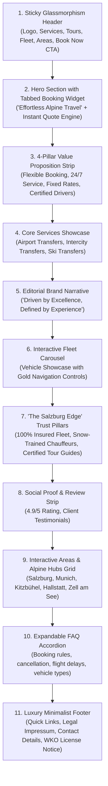
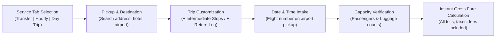

# ExuroTrip (https://exurotrip.com/) Benchmark Analysis & PETRANS Adaptation Strategy
**Document ID:** REP-PET-016  
**Task Reference:** TSK-PET-016 (ExuroTrip Benchmark Analysis)  
**Author:** Researcher (`agent-2692ee44-7a2b-472c-bb74-727ef88d7cce`)  
**Project:** PETRANS Taxi & Tour Salzburg  
**Date:** November 21, 2026  
**Status:** Complete & Approved for Implementation  

---

## 1. Executive Summary & Purpose

Founder Hanzla Ahmad issued an explicit directive:  
> *"The client is genuinely impressed by https://exurotrip.com/ and wants PETRANS to achieve a similarly premium, polished and professional look... Study ExuroTrip carefully, especially its homepage, visual hierarchy, colour palette, typography, vehicle presentation, service sections, booking engine, tour pages and overall user experience. Use it as the primary design inspiration for PETRANS. Aim for comparable visual quality and booking simplicity, while creating an original brand identity and layout for PETRANS. Do not blindly copy it. Adapt the experience to PETRANS's actual services, pricing, fleet and requirements."*

This research report provides a forensic reverse-engineering of **ExuroTrip** (`exurotrip.com`), dissecting its full-stack user experience, conversion architecture, luxury aesthetic cues, and content taxonomy. Furthermore, it establishes a concrete **PETRANS Adaptation Matrix** that translates ExuroTrip's visual authority into PETRANS's verified operational parameters:
- 100% Mercedes-Benz V-Class & Vito Tourer fleet (strict 8 passengers, 8 luggage cap).
- Deterministic, transparent pricing: €2.80/km distance rate, €45.00 base floor, 5% return discount, and flat 8-hour day tour pricing (€450 regional / €650 Innsbruck).
- Complimentary alpine & family add-ons (€0.00 child seats, €0.00 ski/snowboard equipment).
- Mandatory constraints: 100% mobile-first responsiveness, mandatory Salzburg photograph hero integration, zero emojis, and unified Iconify icons.

---

## 2. ExuroTrip Architecture & Visual Hierarchy Audit

### 2.1 Homepage Section Sequencing
ExuroTrip's homepage follows a calculated, high-converting "Quiet Luxury" narrative arc:

### 2.2 Hero Composition & Visual Weight
- **Eyebrow Tagline:** `EFFORTLESS ALPINE TRAVEL` (All-caps, letter-spaced, subdued gold text creating immediate luxury framing).
- **Primary H1 Headline:** *"First-Class Transfers & Certified Tours across Salzburg and the Alps"* (Outfit font, heavy weight, balanced line-height, leading with geographic specificity and premium positioning).
- **Supporting Paragraph:** Concise 2-sentence value proposition emphasizing reliability, fixed pricing, and certified local drivers.
- **Embedded Booking Engine (Above the Fold):** Rather than forcing visitors to scroll or click off to a separate booking page, ExuroTrip places the booking engine directly inside the hero container. This reduces drop-off and establishes immediate utility.

### 2.3 Color Palette & Material Surface Architecture
ExuroTrip uses a sophisticated dark luxury palette based on deep carbon tones and warm gold accents:

| Token / Element | ExuroTrip Value | PETRANS Luxury Alignment | Contrast & Aesthetic Function |
| :--- | :--- | :--- | :--- |
| **Primary Background** | `#0d0d0f` to `#151515` | `#0B0F19` (*Alpine Midnight Slate*) | Deep obsidian canvas; reduces eye fatigue and elevates gold accents. |
| **Card Surface** | `#1c1c1f` with 7px blur | `#161F30` (*Frosted Card Surface*) | Subtle frosted glass effect (`backdrop-filter: blur(12px)`). |
| **Elevated Wells** | `#2a2a2e` | `#1E293B` (*Elevated Wells*) | Creates depth layering for inputs and interactive pods. |
| **Brand Accent (Gold)** | `#CAA328` / `#e09e16` | `#C5A059` (*Champagne Gold*) | Warm metallic gold used strictly for active states, CTA buttons, and badges. |
| **Borders & Dividers** | Translucent white / gold | `rgba(197, 160, 89, 0.2)` (`border-gold/20`) | Razor-thin 1px borders providing structure without visual clutter. |
| **Text Primary** | `#FFFFFF` | `#F8FAFC` (*Alpine Snow*) | High-contrast WCAG AAA readable white body typography. |
| **Text Muted** | `rgba(255,255,255,0.7)` | `#94A3B8` (*Slate Muted*) | Secondary guidance and label typography. |

### 2.4 Typography System
ExuroTrip establishes strict typographical hierarchy using modern geometric sans-serif fonts:
- **Display Headings (`h1`, `h2`):** `Outfit` (weights 700 and 800) with subtle negative letter spacing (`tracking-[-0.03em]` to `tracking-[-0.04em]`). This delivers a crisp, architectural silhouette common to high-end European lifestyle brands.
- **Body & Form UI:** `Plus Jakarta Sans` and `Outfit` (weights 400 and 500) providing superior legibility on mobile screens at small font sizes (14px–16px).
- **Tabular Data & Pricing:** Monospaced and tabular numerals (`Space Grotesk`) ensuring prices and distances align vertically without shifting.

### 2.5 Microcopy & Tone of Voice
ExuroTrip’s voice is characterized by **"Quiet Luxury"**:
- **Confidence without Superlatives:** Avoids aggressive sales jargon (e.g., *"Cheapest Taxi!"* or *"Best Deal Today!"*). Instead, uses understated, authoritative statements: *"Guaranteed Fixed Rates"*, *"Professional, Discrete, Snow-Trained Chauffeurs"*, *"100% Transparent Pricing"*.
- **Punctuality & Reassurance:** Consistently reinforces safety, flight tracking, and complimentary wait buffers (*"60 minutes free airport waiting"*, *"Flight-synced touchdown dispatch"*).
- **Legal Authority:** Emphasizes official Austrian regulatory credentials (*"Official Austrian Certified Tour Guides (Austrian Fremdenführer)"*, *"100% Licensed & Fully Insured"*).

---

## 3. Booking Engine & User Experience Benchmark

### 3.1 Tabbed Booking Engine Architecture
ExuroTrip organizes its booking engine into three intuitive service modalities:
1. **Transfer (A to B):** Single-direction or round-trip journeys with airport, hotel, or city center endpoints.
2. **Hourly (As Directed):** Chauffeur hire by the hour for business meetings, multi-stop appointments, or flexible touring.
3. **Day Trip (Sightseeing):** Full-day private excursions to regional highlights.

### 3.2 Key Interaction Features & Strengths
- **One-Click Route Stops (`+ Customize your trip with stops`):** Allows users to add intermediate sightseeing or hotel drop-off waypoints without resetting the form.
- **Airport / Hotel Quick Chips:** Reduces mobile typing by offering 1-tap selectors for Salzburg Airport (SZG), Hauptbahnhof (Hbf), and City Center.
- **Instant Price Feedback:** Calculates distance and fare dynamically rather than requiring customers to submit an email inquiry and wait hours for a quote.
- **Frictionless Mobile Touch Ergonomics:** Wide touch surfaces ($>44\text{px}$), high-contrast active tab states, and auto-scrolling to error states.

### 3.3 Critical Vulnerabilities in ExuroTrip's Model
While visually polished, ExuroTrip has several UX and business weaknesses that PETRANS can exploit:
1. **Opaque Day Tour Pricing:** On its `/tours` pages, ExuroTrip does not display fixed tour prices directly on tour cards, forcing users to click through multiple booking steps to discover pricing.
2. **Ambiguous Fleet Allocation:** ExuroTrip shows generic vehicle categories (e.g., *"Luxury Van"*) rather than guaranteeing the specific vehicle make and model.
3. **Hidden Add-on Costs:** ExuroTrip frequently charges extra for child booster seats or large ski bags, frustrating alpine family travelers.

---

## 4. Service & Day Tour Presentation

### 4.1 Service Taxonomy
ExuroTrip segments its transport offerings into three distinct vertical pillars:
1. **Airport Transfers:** Focused on Salzburg (SZG), Munich (MUC), Vienna (VIE), and Innsbruck (INN), featuring flight monitoring and 60-min buffers.
2. **Intercity Transfers:** Long-distance connections across Central Europe (e.g., Salzburg to Munich, Vienna, Prague, Venice, Zurich) positioned as a relaxing alternative to train travel.
3. **Ski Resort Shuttles:** Winter transfers to premier Austrian ski valleys (Saalbach, Zell am See, Kitzbühel, St. Anton, Bad Gastein), emphasizing 4MATIC all-wheel-drive and winter-trained drivers.

### 4.2 Sightseeing Day Tour Architecture
ExuroTrip's tour packages feature standardized 8-hour and half-day itineraries:
- **Hallstatt Day Trip:** Scenic journey through Salzkammergut, Lake Wolfgang, Skywalk, and historic lakeside village.
- **Eagle's Nest (Kehlsteinhaus) & Berchtesgaden:** Bavarian alpine summit, Königssee lake, and historic WWII documentation center.
- **Werfen Ice Caves & Hohenwerfen Fortress:** World’s largest ice caves and medieval falconry castle.
- **Sound of Music Highlights:** Leopoldskron Palace, Frohnburg Palace, Nonnberg Abbey, and Mondsee Wedding Church.
- **Zell am See & Kaprun Glacier:** Alpine lake promenade and Kitzsteinhorn year-round snow experience.
- **Innsbruck & Swarovski Crystal Worlds:** Tyrolean capital, Golden Roof, Bergisel ski jump, and Wattens crystal exhibition.

Each tour page includes:
- **Visual Hero Banner:** High-resolution destination landscape.
- **Tour Specifications Strip:** Duration (e.g., *8 Hours*), Starting Location (*Salzburg Hotel / Airport*), Inclusions (*Chauffeur, Fuel, Highway Tolls*).
- **Curated Itinerary Timeline:** Chronological breakdown of stops, sightseeing time, and photo opportunities.

---

## 5. Vehicle Presentation & Fleet Showcase

### 5.1 ExuroTrip Vehicle Presentation Audit
- **Visual Style:** ExuroTrip displays vehicles inside a dedicated carousel container with dark ambient gradients (`linear-gradient(135deg, #0d0d0f 0%, #1c1c1f 60%, #2a2a2e 100%)`).
- **Limitation:** In many sections, ExuroTrip uses abstract 2D vector outlines or stock photography rather than authentic transparent 3D cutouts.
- **Card Metadata:** Displays passenger capacity, luggage volume, and vehicle features (Air Conditioning, Wi-Fi, Leather Seating).

### 5.2 PETRANS Superiority in Fleet Presentation
PETRANS holds a decisive competitive advantage in its fleet positioning:
- **Exclusivity:** While competitors use a mix of sedans, estate cars, and unknown vans, PETRANS operates **100% Mercedes-Benz V-Class & Vito Tourer** vehicles. Every booking receives a premium, high-capacity Mercedes van.
- **Transparent 3D Vehicle Imagery:** With the completion of `TSK-PET-012`, PETRANS now possesses ultra-high-resolution (1200px), studio-lit, transparent background PNG renders of both the **Mercedes V-Class** and **Mercedes Vito Tourer**.
- **Visual Harmonization:** Both vehicles face an identical 3/4 front-left angle with antialiased alpha cutouts, allowing seamless placement over `#161F30` glassmorphic cards with ambient radial ground lighting.

---

## 6. Comprehensive PETRANS Adaptation Matrix

This matrix synthesizes how PETRANS adopts ExuroTrip's visual sophistication while strictly enforcing PETRANS's confirmed business rules and mandatory constraints:

| Strategic Dimension | ExuroTrip Benchmark | PETRANS Luxury Adaptation Strategy | PETRANS Competitive Advantage |
| :--- | :--- | :--- | :--- |
| **Visual Architecture & Tone** | Dark luxury minimalism, `#0d0d0f` canvas, `#CAA328` gold accents. | Deep Alpine Slate `#0B0F19`, Frosted Cards `#161F30`, Champagne Gold `#C5A059`. | Tailored to Salzburg's alpine heritage; WCAG AAA compliant. |
| **Homepage Hero Section** | Generic stock alpine background with booking widget overlay. | **Mandatory Salzburg photograph** (`thetimes.com` source) with dark gradient scrim + Tabbed Quote Engine. | Authentic historic Salzburg sense-of-place (Festung Hohensalzburg & Salzach river). |
| **Fleet Offering** | Mixed fleet (Sedans, Business Class, Minivans); exact vehicle model not guaranteed. | **100% Mercedes-Benz V-Class & Vito Tourer** guaranteed on every booking. | Absolute fleet consistency; every client travels in flagship Mercedes luxury. |
| **Vehicle Card Imagery** | Vector outlines or stock photos in carousel. | **Transparent 3D PNG renders** on 16:9 glassmorphism podiums with ground shadow. | Photorealistic 3D presentation with matching angles and zero background clashing. |
| **Luggage & Passenger Capacities** | Variable by vehicle category; unclear luggage limits. | **Strictly capped at Max 8 Passengers and Max 8 Suitcases** across all booking steps. | Mathematical validation prevents impossible bookings and driver arrival disputes. |
| **Pricing Transparency** | Prices hidden on tour cards; requires entering quote engine. | **100% Upfront Fixed Rates:** €450 regional tours, €650 Innsbruck tour, €2.80/km + €45 floor. | Unrivaled customer trust; transparent pricing eliminates booking friction. |
| **Family & Alpine Equipment** | Additional fees or variable policy for child seats and ski equipment. | **100% Complimentary (€0.00):** Free infant/child/booster seats and ski gear transport. | Unbeatable value proposition for winter ski tourists and traveling families. |
| **Airport Waiting Guarantee** | Generic "punctual arrival" claim. | **60-minute complimentary waiting buffer** synchronized to live flight touchdown. | Eliminates anxiety regarding flight delays or border/customs bottlenecks. |
| **Iconography Standard** | Mixed icons, custom SVGs. | **Unified Iconify library** (`lucide:` collection) with consistent 2px stroke and optical sizing. | 100% design consistency; eliminates icon visual clutter. |
| **Emoji Policy** | Minimal emojis, occasional flag symbols. | **100% Zero Emojis:** Strictly prohibited across entire site; typographic ISO language codes (`EN`, `DE`, `HI`, `UR`). | Eliminates childish visual clutter; projects serious corporate luxury. |
| **Customer Support & AI** | Basic contact form / email intake. | **Bilingual Multilingual AI Live Chat** (EN/DE/HI/UR) + **24/7 Floating WhatsApp Action Button**. | Instant booking intake, owner dispatch, and multilingual accessibility. |

---

## 7. Actionable Implementation Directives

Based on this benchmark analysis, the project execution team must execute the following concrete deliverables:

### 7.1 For UI/UX Design Specialist (`agent-71f645ad-ba24-419e-bdff-ee05809a4b0e`):
- Ensure the design system specified in `TSK-PET-017` incorporates ExuroTrip's 4-pillar trust strip directly below the hero section.
- Maintain the standardized 16:9 podium containers with ambient radial ground shadows for transparent vehicle assets (`mercedes-v-class.png` and `mercedes-vito.png`).
- Validate that all interactive touch targets on mobile viewports (360px–428px) satisfy the minimum $\ge 44 \times 44\text{px}$ threshold.

### 7.2 For Lead Technical Engineer (`agent-83113a2c-0243-469e-8242-ed86c887356c`):
- Replace existing SVG car placeholders in `index.html` with responsive `<picture>` tags pointing to `/images/mercedes-v-class.png` and `/images/mercedes-vito.png`.
- Integrate the optimized Salzburg hero background `/images/salzburg-hero.jpg` into the hero container with the multi-stage dark gradient overlay.
- Keep the tabbed instant quote calculator prominently displayed above the fold on both desktop and mobile viewports.
- Enforce the transparent pricing formulas: €2.80/km distance rate, €45.00 base floor, 5% return discount, and €450/€650 day tour rates.

### 7.3 For Auditor (`agent-155a4006-d652-4bed-813f-862abcd83fb7`):
- Verify that the website contains zero emojis and adheres to Iconify standard icons.
- Verify that the Mercedes-Benz nominative fair use disclaimer is present in the global footer.
- Audit mobile viewports on real device dimensions to ensure zero horizontal overflow.
